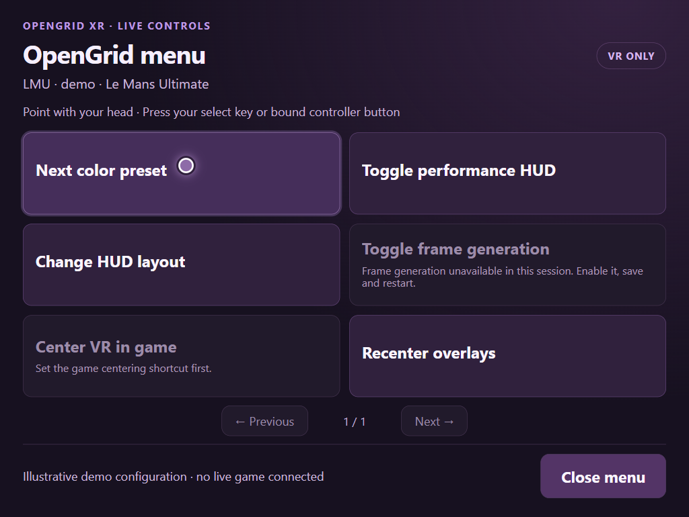
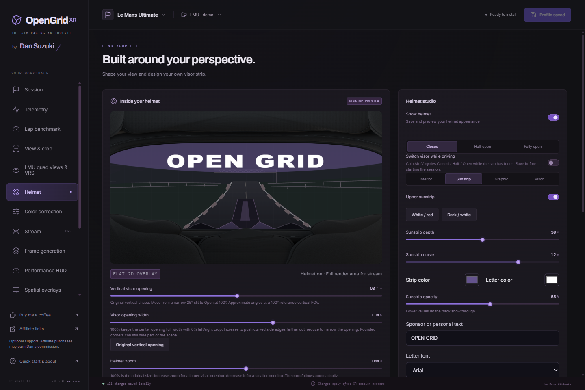
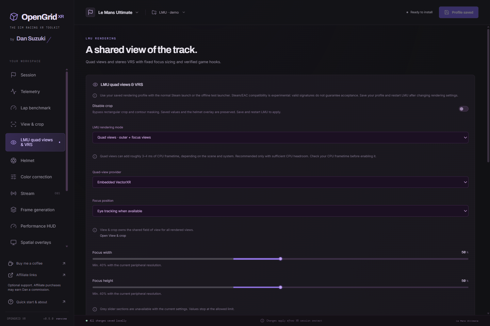
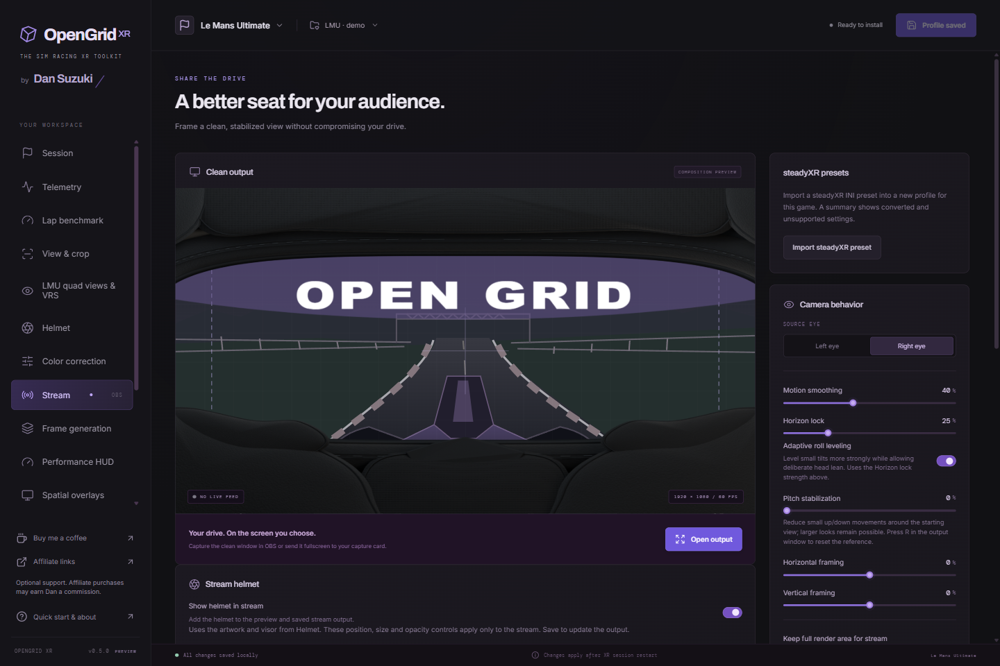
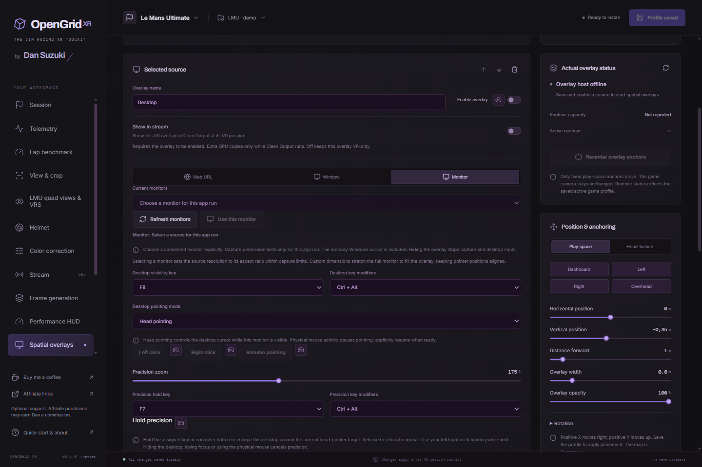

# OpenGrid XR

**The sim racing XR toolkit by Dan Suzuki**

A Windows OpenXR toolkit for **iRacing** and **Le Mans Ultimate**: shape your view, add a helmet or dashboard, adjust the VR image and create a clean stream output. Source-available and free for noncommercial use.

[Download 0.5.2](https://github.com/DSuzuki35/OpenGridXR/releases/latest) · [Getting started](docs/getting-started.md) · [All guides](#guides) · [Build and test](https://github.com/DSuzuki35/OpenGridXR/actions/workflows/build.yml) · [Contributing](CONTRIBUTING.md)

## In the headset

Open the **OpenGrid menu**, point with your head, then press Select. Cycle VR colors, change the Performance HUD, toggle available frame generation, show saved overlays or recenter without opening the editor.

Enable Spatial Overlays, add an **OpenGrid menu** source and save before starting the sim. Default keys: **Ctrl+Alt+F5** to show/hide, **Ctrl+Alt+F4** to select. Wheel/buttonbox bindings are optional and must be learned explicitly. [Menu setup →](docs/quick-menu.md)

## Make it yours

| Helmet and visor | LMU quad views |
| --- | --- |
|  |  |
| Customize original helmet artwork, visor positions and print. | Configure quad providers or stereo VRS; check your rig's support. |

| Clean Output | Desktop and dashboards |
| --- | --- |
|  |  |
| Frame and stabilize a separate output for OBS or a capture card. | Place a monitor, application window or web dashboard in VR. |

*Actual 0.5.0 interface with isolated demo profiles. Scene previews and menu state illustrate configured examples, not a live game or desktop capture.*

## First run

1. Install the Windows setup package from [GitHub Releases](https://github.com/DSuzuki35/OpenGridXR/releases/latest).
2. Select your game and profile. Start with neutral **View & crop** settings, then **Save profile**.
3. Close both sims and Clean Output. In **Setup**, install/update the runtime layer and accept the Windows administrator prompt.
4. Start the sim through **OpenXR**, then check Setup for a connected session.
5. Add optional features one at a time. Save and restart the sim after changing startup settings, render geometry or modules.

There is no global Driving/Streaming switch in 0.5.0. **Stream → Keep full render area for stream** explicitly reserves the full image for output; old profiles migrate automatically. Use separate named profiles for different setups. [Setup, updates and recovery →](docs/getting-started.md)

## Guides

| I want to… | Guide |
| --- | --- |
| Use the headset menu | [Menu and controls](docs/quick-menu.md) |
| Capture a desktop, window or dashboard | [Spatial overlays, head pointing and hold precision](docs/spatial-overlays.md) |
| Change helmet, visor or lettering | [Helmet studio](docs/helmets.md) |
| Design a custom full visor | [PNG / layered PSD templates](docs/visor-templates.md) |
| Adjust VR brightness and colors | [VR-only presets · Ctrl+Alt+F6](docs/color-correction.md) |
| Stream to OBS or a second PC | [Clean Output and render area](docs/streaming.md) |
| Configure LMU quad views or VRS | [LMU rendering and rig checks](docs/lmu-rendering.md) |
| Compare laps or write raw frametime CSV | [Lap benchmarks](docs/benchmarks.md) |
| Read telemetry in another tool | [Read-only telemetry API](docs/telemetry-api.md) |
| Tune frame generation, HUD, sharpening or bindings | [Feature reference](docs/features-reference.md) |
| Inspect OpenXR registrations | [Layer editor](docs/OPENXR-LAYERS.md) |

## Compatibility

Use Windows x64 and a supported OpenXR path. Native OpenVR does not load this layer. Crop/mask savings depend on the game and runtime; enabled settings are not proof of lower frame times. Capture and scene processing primarily support D3D11, with specific supported bridge/quad paths described in the guides. Unsupported paths keep their documented limits.

LMU rendering is experimental and tied to checked executable builds/providers. A protected Steam/EAC cockpit launch has been tested on the documented rig; **online-race acceptance and every headset/provider combination have not been established**. [Evidence and limits →](docs/lmu-rendering.md#verify-at-the-rig)

## Development, authorship and license

See [Contributing](CONTRIBUTING.md) for source builds and verification. Automated/synthetic checks do not replace game and headset testing.

Developed by **Dan Suzuki and contributors**, with OpenAI Codex assistance in code, documentation and debugging. AI assistance is not evidence of correctness or compatibility.

Original work from 0.3.12 uses [PolyForm Noncommercial 1.0.0](LICENSE); dependencies retain their own terms. Earlier license grants remain valid. No expiry, account or paid feature gates. [Credits and license details](docs/credits.md) · [Third-party notices and corresponding source](THIRD-PARTY-NOTICES.md)

Built with work from **DienerTech's VectorXR**, **LMU Quad View Mod**, **Horizonlock VR / SteadyXR**, **SweetFX/LumaSharpen**, **AMD FidelityFX CAS** and telemetry references; **Williem3's Sim-QVFR** inspired the visor controls. Full authorship and license context is in [Credits](docs/credits.md).

Optional support: [Buy me a coffee](https://buymeacoffee.com/dansuzuki) · [Affiliate discounts](https://dansuzuki.com/discounts/). Affiliate purchases may earn Dan a commission; support does not unlock features.
