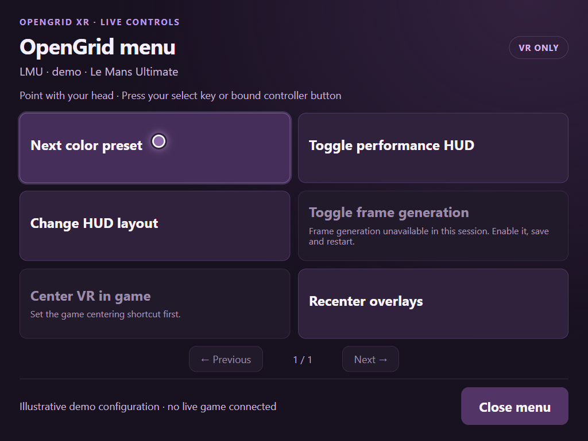
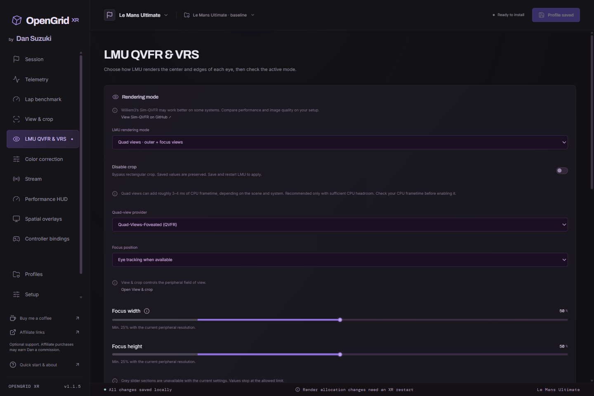
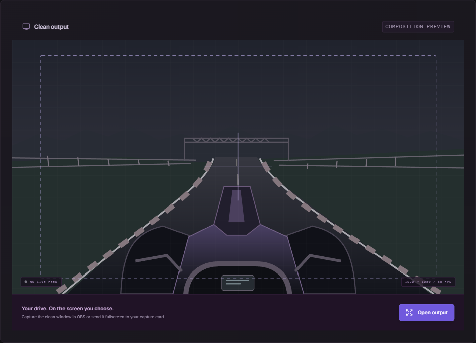

# OpenGrid XR

**The sim racing XR toolkit by Dan Suzuki**

A Windows OpenXR toolkit for **iRacing** and **Le Mans Ultimate**. Place a wheel or dashboard in the cockpit, adjust the headset image and send a stabilized view to OBS or a capture card. Source-available and free for noncommercial use.

[Download the latest stable release](https://github.com/DSuzuki35/OpenGridXR/releases/latest) · [Getting started](docs/getting-started.md) · [Guides](#guides) · [Changelog](CHANGELOG.md)

## No support — contributions welcome

**This project is provided as-is. I do not provide technical support and will not answer DMs about it.**

If you run into an issue, feel free to clone or fork the repository, open it with your favorite AI coding tool, and ask it to investigate and fix the problem. Review and test the changes, then submit a pull request with a short explanation and your test results. See [Contributing](CONTRIBUTING.md) for build instructions. A reply or merge is not guaranteed.

## Version 1.2.0

The latest release adds:

- **Ascher Artura Ultimate:** a 3D wheel with a fitted SimHub display, 21 shift lights and 14 illuminated button symbols. Thanks to Martin Ascher for providing the model.
- **Pimax stereo wheels:** a stereo projection fix contributed by Rak3tenmann addresses duplicated wheels. Four-view sessions retain the existing submission path.
- **Optional wheel occlusion:** choose **3D model without occlusion** to skip cockpit-depth processing for that wheel. Other overlays keep their own settings.

The app retains the cleanup of unnecessary menu entries and features to keep it lean. [Wheel setup and SimHub observer update](docs/steering-wheels.md)

**LMU multi-view rendering.** In **LMU QVFR & VRS**, enable **Multi-view rendering (experimental)**. OpenGrid adds a Direct3D 11 instancing path for compatible hardware alongside the NVIDIA path. After restarting LMU, open **Actual rendered views** to check which rendering path ran and how many focus passes each eye reused. The shader conversion and LMU focus work build on Williem3's Sim-QVFR. [MVR setup and screenshot](docs/lmu-rendering.md#try-multi-view-rendering-in-110) · [Sim-QVFR](https://github.com/Williem3/Sim-QVFR)

**Camera presets and comparison.** In **Stream → Camera behavior**, select **Natural**, **Stream Comfort**, **Strong Leveling** or **Dan Suzuki**. Save and reopen Clean Output. Press **B** in that window for a 20-second comparison with the original camera pose or **P** to pause. The stabilization math and preset values come from Dan Suzuki's HorizonLock VR / SteadyXR. [Camera settings and screenshot](docs/streaming.md#camera-presets-in-110) · [SteadyXR feature comparison](docs/horizon-lock.md)

## In the headset

Open the **OpenGrid menu**, point with your head, then press Select. Cycle VR colors, change the Performance HUD, show saved overlays or recenter without opening the editor.

Enable Spatial Overlays, add an **OpenGrid menu** source and save before starting the sim. Default keys: **Ctrl+Alt+F5** to show/hide, **Ctrl+Alt+F4** to select. Wheel/buttonbox bindings are optional and must be learned explicitly. [Menu setup →](docs/quick-menu.md)

## Make it yours

| Clean Output | Desktop and dashboards |
| --- | --- |
|  | [Desktop and dashboard setup](docs/spatial-overlays.md) |
| Frame and stabilize a separate output for OBS or a capture card. | Mount a SimHub dash on your wheel or place it in the cockpit. [View the placement editor](docs/images/screenshots/dashboard-placement.png) |

## First run

1. Download and run the signed Windows x64 installer from the [latest stable release](https://github.com/DSuzuki35/OpenGridXR/releases/latest).
2. Select your game and profile. Start with neutral **View & crop** settings, then **Save profile**.
3. Close both sims and Clean Output. In **Setup**, install/update the runtime layer and accept the Windows administrator prompt.
4. Start the sim through **OpenXR**, then check Setup for a connected session.
5. Add optional features one at a time. Save and restart the sim after changing startup settings, render geometry or modules.

For a separate streaming setup, create a named profile and enable **Stream → Keep full render area for stream**. [Setup, updates and recovery →](docs/getting-started.md)

## Guides

| I want to… | Guide |
| --- | --- |
| Use the headset menu | [Menu and controls](docs/quick-menu.md) |
| Place a SimHub dashboard behind the driver's hands or on the steering wheel | [Cockpit occlusion and per-car placement](docs/spatial-overlays.md#cockpit-occlusion-for-web-dashboards) |
| Add a 3D steering wheel, map a SimHub screen or import a mesh | [Steering wheel setup](docs/steering-wheels.md) · [Mirror physical wheel LEDs](docs/simhub-wheel-lights.md) |
| Compare camera features with SteadyXR | [HorizonLock feature comparison](docs/horizon-lock.md) |
| Capture a desktop or window | [Spatial overlays, head pointing and hold precision](docs/spatial-overlays.md) |
| Adjust VR brightness and colors | [VR-only presets · Ctrl+Alt+F6](docs/color-correction.md) |
| Stream to OBS or a second PC | [Clean Output and render area](docs/streaming.md) |
| Configure LMU quad views or VRS | [LMU rendering and rig checks](docs/lmu-rendering.md) |
| Compare laps or write raw frametime CSV | [Lap benchmarks](docs/benchmarks.md) |
| Read telemetry in another tool | [Read-only telemetry API](docs/telemetry-api.md) |
| Tune the HUD, sharpening or bindings | [Feature reference](docs/features-reference.md) |
| Inspect OpenXR registrations | [Layer editor](docs/OPENXR-LAYERS.md) |

## Compatibility

Use Windows x64 and a supported OpenXR path. Native OpenVR does not load this layer. Crop savings depend on the game and runtime; enabled settings are not proof of lower frame times. Capture and scene processing primarily support D3D11, with specific supported bridge/quad paths described in the guides. Unsupported paths keep their documented limits.

OpenGrid 1.0.0 integrates LMU Quad View Mod 1.1.0 and includes Quad-Views-Foveated 1.1.4. Choose Native, QVFR or VectorXR for quad views, or select Stereo VRS. Experimental NVIDIA or D3D11 instanced multi-view rendering can reuse a verified focus image for each eye. [LMU setup and rig checks](docs/lmu-rendering.md)

When upgrading, close both sims and Clean Output. Update the app, use **Setup** to install/update the runtime layer, save your LMU profile and restart the game. This integration still needs live headset, protected-launch and frametime validation. [Earlier rig observations](docs/lmu-rendering.md#verify-at-the-rig)

## Development, authorship and license

For source builds, tests and rig verification, see the [contribution guide](CONTRIBUTING.md) and [build workflow](https://github.com/DSuzuki35/OpenGridXR/actions/workflows/build.yml).

Developed by **Dan Suzuki and contributors**, with assistance from OpenAI Codex and Claude Code.

**Markus Stahl** contributed provider integration, performance and stability work to the LMU renderer, as well as OpenGrid 0.6.0’s application, runtime and release-workflow fixes. [Changelog](CHANGELOG.md)

Original work from 0.3.12 uses [PolyForm Noncommercial 1.0.0](LICENSE); dependencies retain their own terms. Earlier license grants remain valid. No expiry, account or paid feature gates. [Credits and license details](docs/credits.md) · [Third-party notices and corresponding source](THIRD-PARTY-NOTICES.md)

OpenGrid builds on DienerTech’s VectorXR, LMU Quad View Mod, Quad-Views-Foveated, Horizonlock VR / SteadyXR, SweetFX/LumaSharpen, AMD FidelityFX CAS and telemetry references. Williem3’s Sim-QVFR supplies shader conversion code for LMU multi-view rendering. The wheel library includes GSI models and the Ascher Artura, with thanks to **Martin Ascher** for providing the Artura model. The renderer and SimHub observer are adapted from oVRlay; **Rak3tenmann** contributed the stereo projection fix for Pimax wheels. [Credits](docs/credits.md)

Optional financial contributions: [Buy me a coffee](https://buymeacoffee.com/dansuzuki) · [Affiliate discounts](https://dansuzuki.com/discounts/). Affiliate purchases may earn Dan a commission. Contributions do not unlock features or include technical support.
