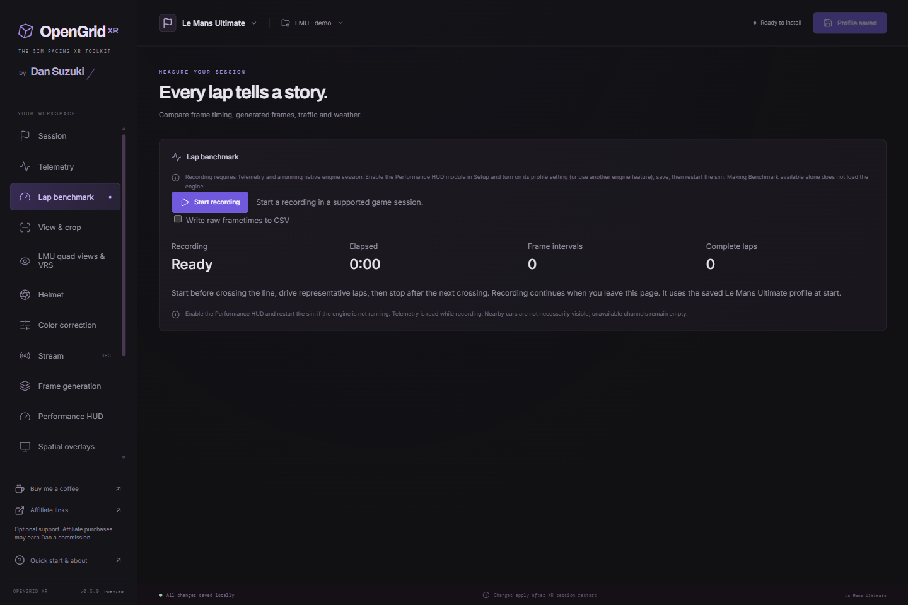

# Lap benchmarks

*Actual 0.5.0 interface with a generic demo profile. Recording is idle; no live measurements are shown.*

Use **Lap benchmark → Start recording** with the sim running. Save profile edits first. Recording requires the current native engine; enable the Performance HUD, save, update the runtime layer and restart the sim if no supported session is found. The HUD can be hidden while recording.

Cross the timing line twice to capture a complete lap. Stop after a later crossing to compare several laps. Recording continues on other app pages and reads telemetry independently of the Telemetry page. Only one game session can be recorded at a time. Closing the app finishes and saves the recording.

Finished recordings are saved as JSON under `benchmarks` in the app data folder. **Export HTML report** creates an offline report with frame-time charts, lap comparisons, conditions, configuration and measurement definitions. **Export CSV data** includes individual frame intervals, telemetry samples, counter intervals and lap boundaries. Neither export loads network resources or uploads data.

Before starting, optionally enable **Write raw frametimes to CSV** (off by default). This writes a separate timestamped `*-frametimes.csv` file while recording, and Benchmark shows its full destination. It contains each accepted application frame once, in native sequence order: sequence, source timestamp, elapsed time from recording start, frame interval, CPU/GPU durations when supplied, missing sequences before the row and the timestamp gap from the preceding row. Times and durations are in milliseconds. Missing measurements stay empty; no CPU/GPU timing is estimated. The first row has no preceding gap, and frames before the recording started are excluded. Existing report exports remain available independently.

CSV writes use asynchronous batches of up to 256 rows, with a 250 ms periodic flush for smaller batches. Stop, session end and app close await the final writes. The queue holds at most 8,192 pending rows, including an in-progress write. If the disk fails or falls behind this limit, logging stops accepting rows and Benchmark shows an incomplete-file error with the destination and saved/unsaved counts; the benchmark report continues. A failed write may have written part of its batch, so only fully completed batches count as confirmed saved. Earlier successfully written rows are retained. Closing the app normally flushes pending rows; forced termination or power loss can interrupt pending writes.

## Measurements

- Application frame intervals, average FPS, 1%/0.1% lows and p50/p95/p99/p99.9 intervals come from timestamped application frame samples. These are not GPU render durations.
- Frame generation counts successful synthetic submissions, with separate application, repeated and total submitted counters. A generated image that never reaches successful submission is not counted as delivered. A successful submission is not proof that the headset displayed it; displayed-frame counts remain unavailable without runtime evidence.
- Source-provided CPU/GPU durations are retained when present. The current native feed leaves them unavailable rather than converting utilization into milliseconds.
- Counter totals use cumulative differences. A counter interval spanning a lap boundary remains in the recording total and is not guessed into either lap. Incomplete per-lap counter coverage is marked.
- Complete laps require two observed consecutive boundaries and continuous telemetry. Starting mid-lap, stopping mid-lap, skipped laps, resets and telemetry gaps produce partial segments. Observed boundary timestamps have polling uncertainty; the sim's reported lap time is separate.

## Racing context

The report correlates speed, pit state, temperatures, precipitation, wetness, cloud category, session clock and time of day where supplied. iRacing's solar altitude distinguishes sun above/below the horizon; a clock value alone is not labelled day or night. Missing channels remain unavailable.

Nearby traffic means **within 100 metres**, excluding the player. In iRacing this is wrapped distance along the track using lap percentage and track length. In LMU it is distance between world positions. These measure different things and are labelled accordingly. Neither is the number of cars visible on screen; that channel remains unavailable.

The recording stores the selected profile's relevant configuration for interpretation. Compare runs on the same circuit with similar traffic, weather, car and camera settings. A pixel ratio is not a measured GPU saving and a short recording is not a representative full-race benchmark.

## Resource limits

The native frame history is allocated only while a fresh recording request exists and retains at most 1,024 recent intervals. The desktop polls the feed at most four times per second and telemetry at up to 20 Hz. Recordings stop at their sample or duration limit (250,000 frame intervals or two hours by default); stopped, missing or restarted sessions cannot silently join another recording. Frame gaps and counter resets are reported explicitly.
