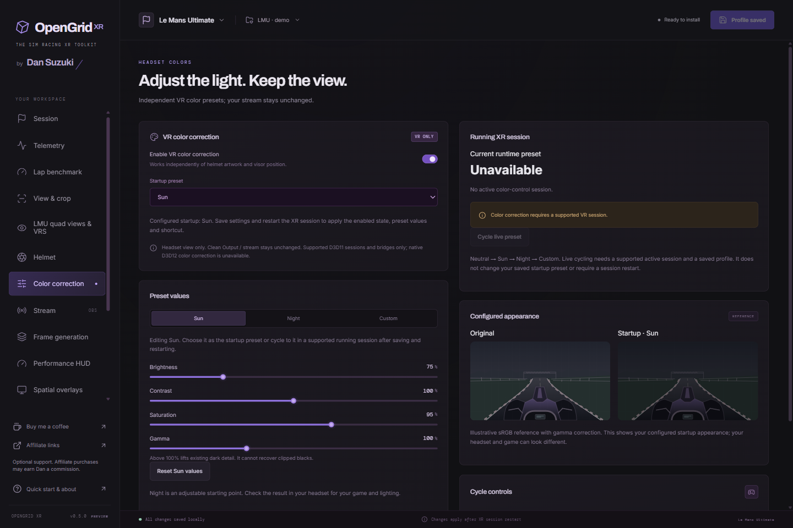

# VR color correction

*Actual 0.5.0 demo configuration. The reference scene illustrates the startup preset; no live game is connected.*

Color correction changes the VR game image independently of helmet artwork, visor position, and the Helmet module. Clean Output and stream capture remain ungraded. Game HUD drawn into the scene is part of that image; separately composed headset HUD, helmet and spatial overlays are added afterward.

Enable **Color correction**, choose a **Startup preset** and save before starting a new XR session. Presets cycle in this order:

| Preset | Initial appearance |
| --- | --- |
| Neutral | Exact identity; no color-grading GPU pass |
| Sun | Reduced brightness for a darker view |
| Night | Increased brightness and gamma, with slightly reduced contrast/saturation |
| Custom | Neutral starting values, freely adjustable |

Sun, Night and Custom have brightness/contrast (50–150%), saturation (0–150%) and gamma (50–200%) controls. Neutral is fixed at 100% throughout. Night lifts existing dark image detail; it cannot restore detail already clipped to black. Reference scenes illustrate the configured startup preset, not the current live headset image.

Use **Cycle live preset**, the configurable keyboard chord (default **Ctrl+Alt+F6**) or the controller binding beside **Cycle controls** while a supported session is focused. Cycling is live and does not rewrite the saved startup preset. Editing values or the startup preset requires saving and restarting the XR session. The panel reports the actual runtime preset separately, including unavailable or unsupported sessions. An explicitly unbound chord stays unbound.

The processing path supports D3D11, including supported D3D11-to-D3D12 bridges and LMU quad-view images. Native D3D12 game bindings and unsupported projection formats do not receive a simulated effect. Active grading shares the existing sharpening pass where possible; otherwise it requires its own GPU scene pass and cached texture copies. No game performance improvement is implied. Neutral bypasses grading; disabling the feature avoids its session control work.

Both eyes and all four quad views use the same frame's preset. Raw stream snapshots occur before grading. Runtime control checks session ownership, freshness and focus; old commands do not replay after focus/session changes. No eye tracker is used.

Old effective scene brightness/contrast/saturation values migrate to enabled Custom. Previously inactive values remain disabled Custom, including when the Helmet module was disabled. The old Helmet editor scene sliders are retired so there is one place to edit image correction.
