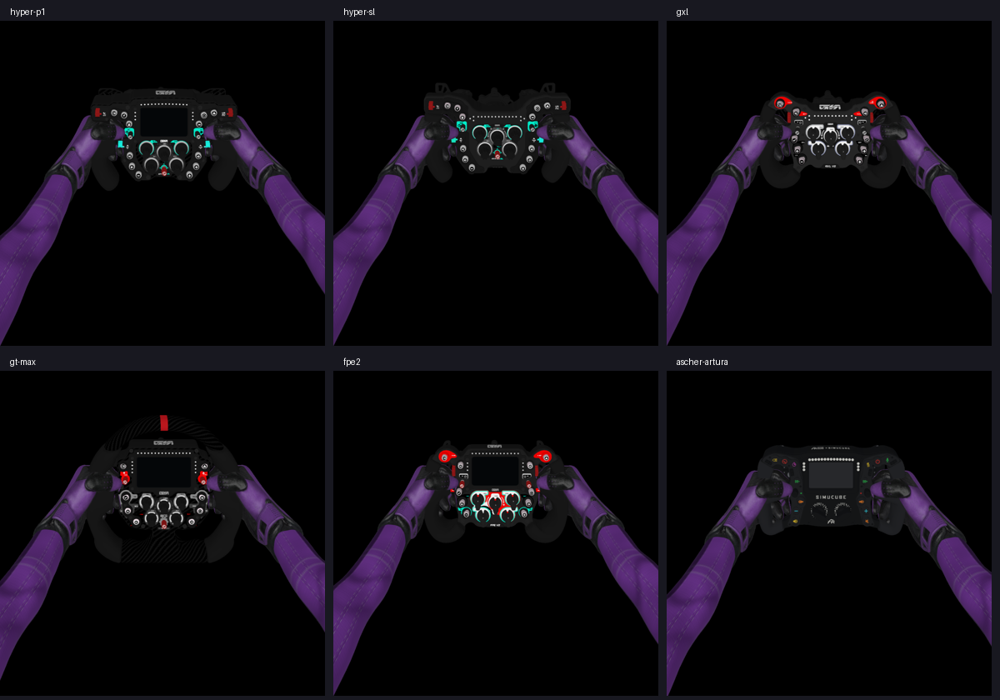
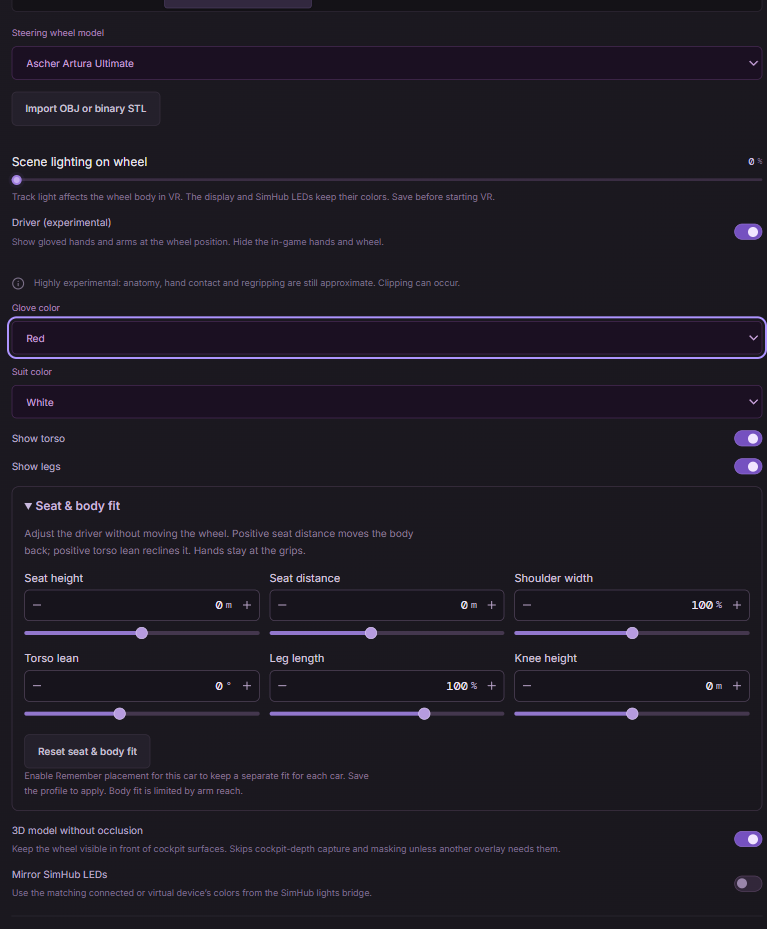

# Virtual driver (experimental)

**Highly experimental:** anatomy, grip and regripping are still approximate.
Expect clipping and imperfect elbows. Compare frametimes with the driver off/on.

In **Spatial overlays**, choose any built-in **3D wheel**: **Ascher Artura Ultimate**,
**GSI Hyper P1**, **Hyper SL**, **GXL V2**, **GT-MAX 32** or **FPE2**.
Enable **Driver (experimental)** and save the profile. Select
separate colors for the gloves and suit: Purple, Black, Red, Blue or White.
Torso and legs can be shown independently; both start off.

Place the wheel as usual. Enable steering follow for the hands to follow the
game's steering angle. Hide the game's own wheel/hands in its settings to avoid
seeing two drivers. Driver controls are saved with the overlay/profile.

Steering-axis offsets up to 5 cm and tilt up to 10 degrees are supported in
this version. The editor explains unsupported placements and offers **Use centered
axis** without silently overwriting your calibration.

The hands begin regripping at 70 degrees. Both steering directions are supported.
Geometry is rendered with the wheel in one depth pass, so fingers can pass
behind its handles. The driver can be disabled without restarting the game.

Driver controls are available for the six built-in models only. Custom imported
wheels do not yet have calibrated grips. The GSI models share a driver asset;
Artura has its own fit. Body dimensions stay independent of wheel width;
the hands follow the wheel's grip placement.

## Fit the seat and body

Open **Seat & body fit** below the glove/suit controls. Each field supports
direct decimal entry, sliders and fine increment buttons.

- **Seat height:** lower the body if the shoulders sit near your ears.
- **Seat distance:** positive values move the body back from the wheel.
- **Shoulder width:** adjust the shoulders without widening the wheel.
- **Torso lean:** positive values recline the upper body.
- **Leg length:** shorten the legs if the feet extend through the floor.
- **Knee height:** adjust the seated bend while preserving leg segment lengths.

Save the profile to apply. With **Remember placement for this car** enabled,
these values belong to that car's wheel placement. **Reset seat & body fit**
resets only the body adjustments; wheel placement, colors and visibility stay.
The renderer limits upper-body adjustments to keep the hands within reach.
The editor reports when a requested fit exceeds the supported pose.
If a wheel size or pose cannot keep the arms and wrists within their supported
limits, the driver is hidden while the wheel remains visible. Reduce the wheel
width or reset the body fit. Calibration is cached; changing the fit can cause
a brief frame-time spike while the steering range is checked.

Gloves and sleeves have color and normal textures, stitched panels and sleeve
folds. Fabric detail is baked, not physically simulated. A loaded driver uses a
1536-pixel render target; ordinary wheels keep their existing resolution.
Assets load in the background. Driver targets are released after the last
driver slot is disabled. In-game frametime impact has not yet been measured.

This feature uses authored steering poses and a fixed seated body. It does not
track your physical hands, body or feet. Live paddle animation is not included
in this first integration. Body proportions, close-up clipping and cloth
deformation still need headset evaluation. Optional torso/legs increase the
visible area and rendering work; compare frametimes with the driver off/on.

Asset credits: [Valve, Elvaerwyn and MakeHuman](../assets/drivers/NOTICE.md).
