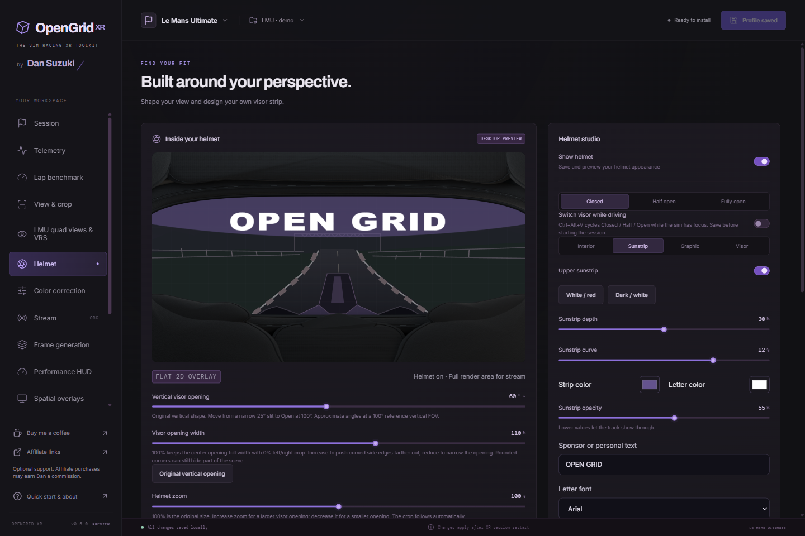
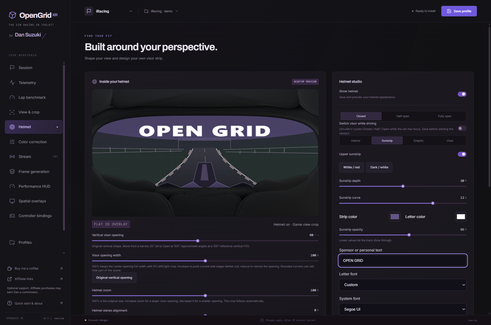

# 2D helmet overlays and visor editor

OpenGrid XR includes original Formula, GT, Open and Level 3 helmet interiors built from
editable Blender geometry. They are physically inspired driver-eye cutaways, not
measured replicas or optically calibrated models of a particular headset. The
geometry, generated artwork and scripts use this repository's PolyForm Noncommercial 1.0.0 license from version 0.3.12 (earlier published grants remain valid).
No manufacturer photographs, logos, downloaded meshes or external textures are
embedded in the supplied assets.



*0.5.0 demo configuration; scene preview is illustrative, not a live game capture.*

## Helmet missing in VR?

Version **0.5.1 fixes the helmet artwork path for systemwide runtime installations**. Earlier builds could load cropping and frame generation correctly while looking for the helmet's saved files in the wrong directory.

1. Install 0.5.1 or later, close both sims and Clean Output, then use **Setup → Update runtime layer**. Updating the editor alone does not replace the loaded layer.
2. Select the profile for your game, enable **Show helmet**, save and restart the sim in OpenXR.
3. If the helmet is still missing, test once with HUD/spatial overlays and frame generation disabled, then report which game/runtime and settings reproduce it.

**“Headset validation required” is a general compatibility notice**, not a detected fault or a switch that disables the helmet. This path fix is covered by D3D11 and D3D11-on-D3D12 tests; it does not establish validation on every SteamVR/headset combination.

## Artwork and display

Each style has a padded shell, gasket, stitched seams, cheek pads, fasteners and
an actual curved polycarbonate visor surface. The shell, liner, gasket and all
attached details wrap around the same vertical axis and 2.9 model-unit radius as
the visor. They are not a flat ring behind curved glass. The visor stays offset
in front of the gasket; rim thickness and padding remain three-dimensional.
Editable reference sunstrip and
mirrored `OPEN GRID` lettering meshes follow that surface. They can be inspected
from inside and outside in the `.blend` source; these cutaways are not complete
wearable helmets for arbitrary viewpoints.

The upholstery uses original smooth lofted panels, inset seams, sculpted cheek
bolsters and procedural woven/perforated materials. Reference photographs and
third-party helmet graphics are not embedded, sampled or shipped as textures.

| Asset | Location | Purpose |
| --- | --- | --- |
| Editable source | `assets/helmets/<style>.blend` | Geometry, sample print, lights and three cameras |
| 2D shell | `public/helmets/<style>.png` | Shared image for both eyes |
| Mono projection maps | `public/helmets/<style>-mono-visor-uv.png`, `-mono-visor-v.png` | Print coordinates matching the 2D shell camera |
| Earlier stereo references | `public/helmets/<style>-left.png`, `-right.png` and their maps | Authoring references, unused by the editor or runtime preparation |

Images are 1920 × 1080 RGBA. The helmet is a flat, head-following 2D overlay.
Both eyes receive the same finished artwork, without separate stereo renders
or simulated helmet depth. Curved Blender geometry supplies the image's
appearance and visor printing, not an in-headset 3D object.

Composition order is game projection, helmet, then HUD and other overlays.
The helmet is the lowest overlay above the game image. The native renderer
retains two FOV-aligned quad submissions to cover asymmetric headset views;
both use the same artwork. No helmet mesh is rendered during a race.

## Visor positions and texture detail

**Closed**, **Half open** and **Fully open** move the complete visor material, tint, strip and printing behind the stationary brow. These are three discrete positions, not a continuous animation. A clear visor with a short strip may look fully clear already at Half open because the strip is hidden behind the brow.

Enable **Switch visor while driving** to cycle with **Ctrl+Alt+V** while the sim has focus. Save first. A held key does not repeat; switching affects only the current runtime session. Saving/reloading a profile restores its chosen starting position. Native decoding and static texture uploads happen at state changes, not every frame; switching can have a one-time loading cost. An unavailable or inconsistent variant retains the last valid visor.

From **0.5.2**, bind a wheel, joystick or buttonbox button/POV using the gamepad icon next to **Cycle visor position**, or find the same action under **Controller bindings → Helmet**. Enable **Show helmet** and **Switch visor while driving**, learn the input and save before starting the sim. Each press cycles **Closed → Half open → Fully open → Closed**. Keep OpenGrid XR running for controller bindings; the game window and XR session must have focus. The keyboard shortcut remains available. After updating the app, also update the runtime layer with the sims closed.

With live switching, automatic crop fitting always reserves the fully open view. An opaque closed sunstrip cannot justify cutting away scenery that opening it will reveal. With switching disabled, crop can fit the selected static position more tightly. Manual crop edits can override this safety, so use **Fit crop to visor opening** after such edits. Render crop is fixed for the running game session; restart after changing it.

**Performance** bakes 2048 × 1152; **Detail** bakes 4096 × 2304. These are final output texture sizes. The visor-print intermediate remains fixed at 1600 × 900, so Detail is not a true 4K font-rendering mode and cannot add detail absent from the print or original 1920 × 1080 artwork. The desktop preview stays at a fixed size. If runtime texture limits cannot accommodate the image plus movement/stereo padding, the native loader reduces the image to fit while preserving its proportions and alpha. All variants use the same dimensions.

The visor and helmet stay flat and are composited after frame generation, including synthetic frames, beneath HUD and spatial overlays. Optional scene-lit shading is not included: interior brightness/contrast/saturation remain explicit appearance controls. Scene adjustments now live in independent [VR color correction](color-correction.md), which can remain active with any visor position or no visible helmet. Clean Output stays ungraded. Colored glass itself still moves in Half open.

Visor positions and detail presets were inspired by [Williem3's Sim-QVFR / ace-quadview](https://github.com/Williem3/Sim-QVFR), credited in the editor and [third-party notices](../THIRD-PARTY-NOTICES.md). This is an independent implementation with original OpenGrid artwork; no Sim-QVFR source or images are included.

## Customization and saved headset images

For an entire visor design, choose **Graphic → Custom** and use the [PNG / layered PSD templates](visor-templates.md). The existing **Logo / strip** option keeps logo placement unchanged.

For an installed font, choose **Sunstrip → Letter font → Custom**, then select a **System font**. **Refresh system fonts** rechecks fonts installed since opening the app. Profiles store the family name, not font files: install the same family on another PC or choose a replacement. Missing families render with Arial. System-font enumeration runs only when requested in the Windows app.



*Actual 0.5.1 editor with a generic demo profile and Segoe UI selected; no live game capture.*

The editor projects strip color, text and uploaded raster graphics through the
Blender-rendered maps. Lettering bends with the surface and is mirrored by
default, like exterior print viewed from inside. White/red and dark/white presets
are starting points; text width, size, position, opacity and softness remain
editable. Full visor tint color and strength are independent of the upper strip.
**Text curvature** bends the complete lettering along the visor band, from −25
to +25; zero stays straight. Positive values raise the outer ends while keeping
the center anchored. Text width, position, mirroring, opacity and softness still
apply independently. White/red and dark/white presets use a curvature of 12;
older profiles without this setting retain straight lettering until adjusted.
PNG, JPEG and WebP uploads are decoded and normalized to embedded PNGs of at most
192 KB and 1024 × 512 pixels. Exported profiles carry their graphics.

The preview and profile-save preparation use the same canvas compositor. Saving
bakes the selected static composition and writes byte-identical PNGs to the two existing runtime
filenames for compatibility. Live switching also prepares fixed Half/Open images. The hidden renderer
is sandboxed, denies navigation/network requests and is destroyed afterward.
Unchanged appearances reuse cached images. A generation-tagged sidecar is
disabled before replacing any image, then enabled after the complete variant set is ready. The
native loader rechecks it after decoding to reject changed generations. It uses
the canonical left filename for both eyes, including older sidecars. Failed
preparation leaves that helmet disabled.

The headset layer submits the shared 2D raster. It does not render Blender meshes,
reproject text, or run Blender during a race. Helmets can remain on in driving
and streaming modes; the clean stream excludes headset composition layers.
For an independent output helmet, enable **Stream → Show helmet in stream**.
It reuses the selected artwork and visor, with separate position, size and whole-overlay
opacity. Save to prepare and update the output artwork; headset placement, movement
and shell opacity do not affect these stream controls.
Desktop screenshots do not establish headset alignment, comfort or an active
OpenXR session.

## Genuine scene adjustments

Brightness, contrast and saturation process the game scene separately from the
alpha-overlay tint. They run in that order on display-encoded color in the native
D3D11 image-processing path, before helmet, HUD and spatial layers. This includes
D3D11 games using the frame-generation bridge. Native D3D12 game sessions do not
support these adjustments. Clean stream capture remains before grading. Neutral
values are 100%; save and restart the XR session after changes. The editor uses
the same adjustment order.

## Crop and motion

`Helmet zoom`, directly below the preview, scales the complete helmet, sunstrip
and print together from 50% to 150%. 100% restores the original size. Higher
values enlarge the visor opening; lower values shrink it. Zoom is saved per
profile and does not change scene magnification or automatically replace crop.

`Fit crop to visor opening` explicitly updates a linked contour for both eyes and
the shared crop. It derives a conservative convex envelope containing every
nonopaque finished-overlay pixel, adding configured mask padding and a small raster margin.
Translucent visor tint and print never justify hiding scenery behind them.
Semi-transparent shells consequently offer little or no safe crop.

Optional head and vehicle responses default to zero. Enabling either adds a 3%
motion allowance; the native compositor caps movement at 3% of each image
dimension. Vehicle response reads live iRacing/LMU acceleration in the native renderer, independently of whether the desktop Telemetry page is open. Advancing samples are required; data older than 250 ms is ignored and motion settles back to neutral. Both effects are damped over approximately 80 ms and capped at one degree combined. The response values are strength percentages, not degrees. Refit after changing shell
scale, position, opacity, padding or motion. Saving does not silently overwrite
crop. Crop/contour stay inactive in streaming even when the helmet remains on.
Cropping reduces visible/rendered image area; it does not change optical FOV.

After upgrading from stereo helmets, refit the crop, save the profile, update
the runtime layer and restart the sim. Hand-tuned crop settings are not silently
overwritten.

## Reproduce the assets

Blender 4.5.15 LTS is an authoring dependency; end users do not need Blender.
From the repository root:

```powershell
blender --background --python scripts/render-helmets.py -- --style all --samples 48
blender --background --python scripts/render-helmets.py -- --verify
blender --background --python-exit-code 1 --python tests/helmet-geometry.py
```

`--stereo-only` preserves mono PNGs while regenerating scenes, stereo shells and
maps. `--maps-only` regenerates maps from saved scenes without rebuilding the
shell. Use `--style formula`, `gt` or `open` for one style. A draft can use
`--width 960 --samples 24`; verification expects final 1920 × 1080 assets.

UV export first renders floating-point coordinates to temporary EXRs, then packs
each coordinate into the red/green bytes of a lossless PNG. Packing after sample
filtering avoids dither artifacts. Temporary EXRs are removed; only static PNG
maps ship. Base shell renders hide visor/reference print while retaining their
geometry in the source. Regeneration overwrites matching `.blend` and PNG files;
update the generator to preserve authoring changes reproducibly.

Verification covers source geometry, RGBA dimensions, a clear central view and
matching mono coordinate maps. Electron tests exercise identical saved eye
images, alpha, generations, caching, profile round-trips, fitting and presets.
Native fixtures check canonical mono pixels and composition below other overlays.

## Design references

Geometry is original. Construction references include [Bell's official HP77 and
SmartLock description](https://www.bellracing.com/press-release/bell-racing-helmets-launches-the-innovative-smartlock-visor-locking-system/),
the [FIA HP77 presentation form](https://www.fia.com/sites/default/files/ah.008.19-c-abp_-_presentation_form_v14_0.pdf),
and [Arai's car-helmet feature overview](https://www.araihelmet.eu/storage/uploads/blocks/816/block_2/1/arai-2024-features-overview-car-eng.pdf).
These references do not certify the simulated artwork as an exact optical model.

The flat helmet uses one shared head-space image envelope for both eyes, including
asymmetric or canted headset views. Per-eye origins cancel IPD parallax; the same
artwork and sway sample are used in both eyes, avoiding doubled visor edges.

`Helmet stereo alignment` below the preview shifts the helmet artwork horizontally
in opposite directions per eye, from -5% (inward) to +5% (outward) in 0.1% steps.
Zero is neutral; Reset restores zero. The game projection and headset optical
settings are unchanged. Save to apply in the headset; the single-eye desktop
preview stays centered. Adjust in small steps; the crop margin updates automatically:
the shared crop reserves both shifted openings as well as any motion margin.
`Interior > Vertical position` moves helmet and visor together up/down in both eyes.

`Vertical visor opening` continuously moves the upper and lower interior from a
narrow slit (25°) to Open (100°). These are approximate angles using a 100° vertical
reference FOV, not a headset measurement; zoom, position and the actual headset FOV
change the perceived angle. The horizontal `Visor opening width` is independent:
100% spans the image center, values above 100% push the rounded side edges farther
out, and values below 100% narrow the opening. New profiles default to 100% width.
Opening changes refit the contour and crop together. Left/right crop defaults to
zero for widths of 100% or more. Rounded corners may still obscure the scene even
with zero rectangular side crop. Existing profiles retain their original shape
until edited; `Original vertical opening` restores the selected model's vertical shape while preserving width.

Under Interior, brightness, contrast and saturation affect only the padded helmet
PNG, independently of the visor print/tint and scene grading. They preserve alpha
and therefore the aperture. Reset interior colors restores the original grading.
Both shape and color changes are baked when saving; no additional per-frame 3D
rendering is introduced.

The rectangular crop adjusts projection and the recommended render dimensions.
The curved contour adds hidden triangles through `XR_KHR_visibility_mask`; it can
save pixel work only when the game requests and uses that hidden mesh. Drawing the
helmet PNG alone does not save game rendering work. Mask requests do not prove a
measured FPS gain; compare frame timings in the same scene. See the
[OpenXR mask definitions](https://registry.khronos.org/OpenXR/specs/1.0/man/html/XrVisibilityMaskTypeKHR.html).

In 0.3.8, lettering and graphics are fitted proportionally into the reshaped
sunstrip instead of being flattened with the opening. Small strips may reduce
the complete print uniformly to keep it inside the visible area.
Position, zoom, model, opacity, motion and alignment changes update the crop
atomically. Extended border pixels prevent exposed scene strips when translating
or shrinking the helmet image, including fractional-pixel positions.
`Helmet blur` (0–8 px at the editor reference size, default 0) softens the
complete overlay, including visor print and graphics, after layout and composition.
Print is fitted against the sharp geometry, so blur never shrinks or repositions it.
The fitted aperture includes newly translucent blur pixels. The game image stays
sharp. Blur is baked into the saved PNG and adds no per-frame blur pass.

Under Sunstrip, `Letter font` selects Arial, Arial Narrow, Impact, Georgia,
Consolas or Trebuchet MS. These use Windows system fonts without downloads.
Old profiles default to Arial. The selection is saved/exported with the profile
and applies to both desktop preview and the baked headset image.


## Level 3 easter egg

Helmet studio → Interior → Level 3 selects an original armored slit-window
interior inspired by battle-royale helmets. It selects the narrow 25° vertical
opening and preserves your width. The steel plate, wear, screws and padding are
procedural Blender geometry/materials, with no photograph or game assets copied.
The finished PNG uses the same inexpensive 2D pipeline and customization controls.

## Visible-area crop

Automatic fitting reads alpha from the finished overlay after visor, print, shell,
position, zoom and blur. A fully opaque sunstrip can reduce the required image
area. Any nonopaque output pixel is preserved, including a translucent strip and
blurred edges. The contour is a conservative convex envelope, with additional
padding, stereo-alignment and motion allowance; the rectangular crop encloses it.
Existing crop limits remain in force, so an extremely narrow slit does not imply
that every hidden pixel is eliminated. A visibility mesh only reduces game work
when the game consumes it. No per-game performance improvement is asserted.

Original vertical opening resets only the vertical shape and preserves width
(default 100%, with no left/right rectangular crop). Visor edits refit atomically
with the appearance, so making a strip translucent reopens the image immediately.
With **Keep full render area for stream** enabled, the game renders the full scene and the saved render crop/contour remain inactive.
