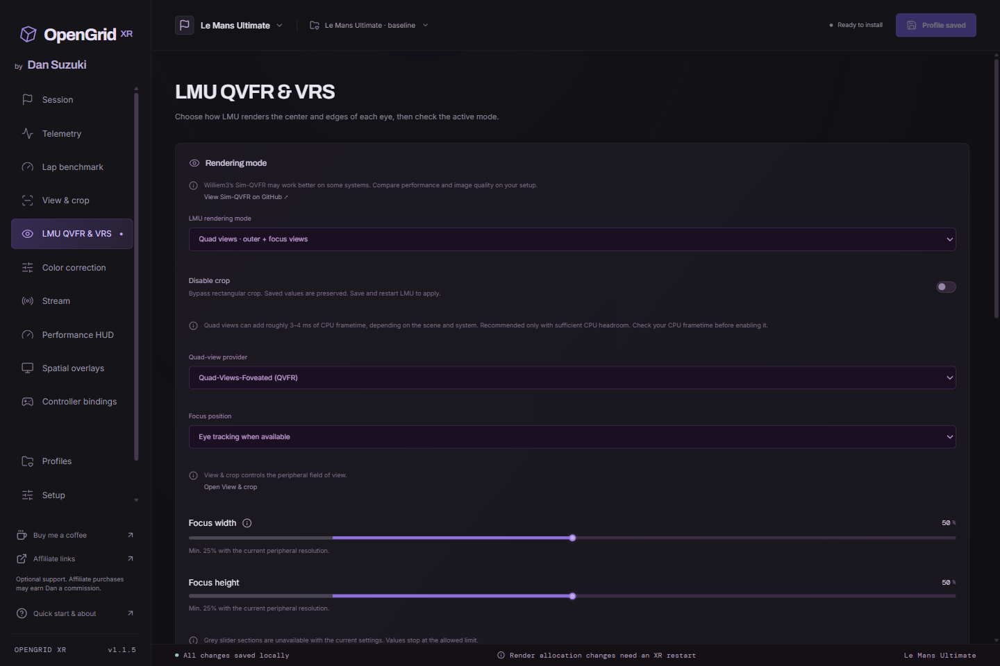
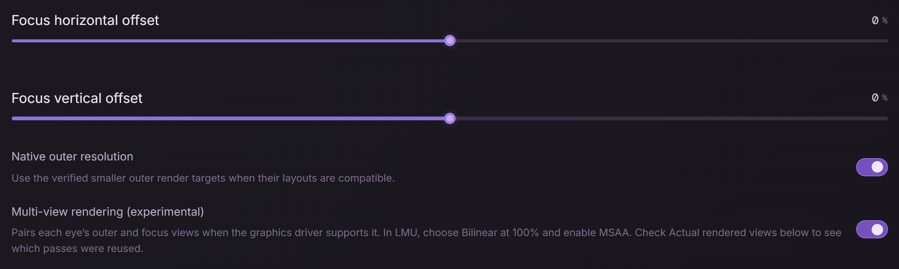

# LMU QVFR & VRS

OpenGrid links Dan Suzuki's LMU Quad View Mod into `OpenGridXR.dll`. Markus Stahl contributed provider and performance work, and Matthieu Bucchianeri developed the bundled Quad-Views-Foveated provider. The integrated upstream source reports **1.1.0** at commit `4a618648d90040e8e7e454d5dbac4e7613e7778f`. [Integration provenance](../native/third_party/lmu_quadview/OPENGRID-PROVENANCE.md) · [Quad-Views-Foveated](https://github.com/mbucchia/Quad-Views-Foveated)



*OpenGrid 1.0.0 with the LMU demo profile.*

MVR retries each eye independently after an unusable focus pass and reuses validated input-layout metadata across consecutive draws. These changes draw on Williem3’s recent work. [Technical comparison with Sim-QVFR 1.1.1-beta](research/sim-qvfr-1.1.1.md)

## Use

1. Close both sims and Clean Output. After installing or updating the app, open **Setup** and install/update the runtime layer.
2. Enable the LMU rendering module and select your LMU profile. On **LMU QVFR & VRS**, select **Quad views** and a provider, or **Stereo VRS**. Ordinary stereo is the default.
3. Save the profile and start LMU in OpenXR through Steam. Restart LMU after changing the mode, provider, geometry or optimization settings.

For the optional offline launcher, select the game executable and use **Check launch** first. Executable resource, code-anchor, x64 function-boundary and independently anchored data-layout checks run in the native adapter; the launcher records the executable hash for diagnostics without requiring one fixed hash. A future game update can still fail those guards.

Quad views add scene work for the focus views. To compare modes on your rig, repeat the same scene at the same render resolution and inspect CPU and GPU frametimes. Live headset performance for this 1.0.0 integration has not been measured.

## Try multi-view rendering in 1.1.0

OpenGrid supports D3D11 instancing alongside NVIDIA XYZW single-pass stereo. Both paths can draw an eye's outer and focus views together. The D3D11 path requires a driver that allows a vertex shader to select the viewport (D3D11 Options3). OpenGrid uses shader conversion and LMU focus-rendering work from **Williem3's Sim-QVFR**. [Sim-QVFR source](https://github.com/Williem3/Sim-QVFR) · [Imported converter and license](../native/third_party/lmu_quadview/mod/vendor/sim_qvfr)

1. In **LMU QVFR & VRS**, select **Quad views** and your provider. Under **Advanced rendering settings**, turn off **Outer SSR**. Leave stereo draw audit off.
2. Enable **Multi-view rendering (experimental)**. OpenGrid also enables **Native outer resolution**. Save your profile.
3. In LMU, select **Bilinear** image scaling at **100%** and enable **MSAA**. Restart LMU in OpenXR and load the cockpit.
4. Open **Actual rendered views → Focus passes this session**. The **Rendering path** field identifies NVIDIA multi-view or Direct3D instancing. Watch the **reused** count for each eye while driving. The **native** count includes frames used for qualification and fallback.



*The screenshot shows the requested settings in the beta editor. The per-eye counters appear when the game reports a session.*

The renderer draws the outer and focus scene for the same eye together. It compares paired HDR results against the native focus image on two frames for each eye before skipping a focus scene pass. A consistent brightness difference of 2% or more in the tone-mapped comparison keeps that eye on native focus rendering. If the target, projection, shader or image comparison fails, that eye uses ordinary focus rendering. The instanced path preserves the game's instance IDs and per-instance input data. A screen-space pixel shader, incompatible shader texture, unknown input layout, unsupported draw count or nonzero base instance keeps that eye on native focus rendering. Pixel readback tests verified both viewport regions for direct, indexed and instanced draws on Windows WARP, an NVIDIA GeForce RTX 5090 and AMD Radeon integrated graphics. The hardware fixture exercises D3D11 outside the game. In-headset brightness, Intel hardware and LMU frame times remain unverified.

Extra focus passes, including retries, meter the scene with a near-zero positive time so they do not appreciably advance YEBIS exposure history. The renderer restores the game's time before autofocus, motion blur and other postprocessing. Native eye metering and paused effects keep their original time. The adapter verifies the exposure routine, its call site and the time-field reader and writer before enabling the hold. Stereo VRS uses a separate two-view path.

An **armed** status means the driver path initialized. **Last MVR fallback** identifies the most recent refusal, including which eye could not validate its focus image. For example, a missing MSAA resolve can leave an eye using ordinary focus passes while the other eye continues to reuse its paired image. **MVR stopped** gives the startup or driver failure when the backend is unavailable. With verbose diagnostics enabled, a mid-session backend stop also logs pass totals, per-eye fallback and validation counts, and the last prepared outer and focus dimensions.

## Rendering options

Normal launches keep profiling and verbose diagnostics off. The LMU page reports startup and hook failures, including those before session creation, and the CPU scheduling outcome. Under **Advanced rendering settings**, these optional quad-view controls default off.

| Option | Behavior |
| --- | --- |
| CPU upload reuse | Reuses verified uploads across focus views; disables batching. |
| CPU upload batching | Batches verified uploads; disables upload reuse and outer reuse. |
| CPU outer reuse | Reuses verified outer-view CPU work; enables upload reuse and disables batching. |
| Outer SSR | Outer-view screen-space reflections; requires **Native outer resolution**. |


Save and restart LMU after a change. Compare frametimes and inspect image quality on your rig. These quad-only flags are disabled in Stereo VRS even if an inactive profile retains their values. The obsolete **Outer smoothing** control has been removed; old saved smoothing values are ignored.

**Prefer AMD 3D V-Cache cores** defaults off for new installations and when no preference has been saved. An explicit saved on/off choice is preserved for this PC. On eligible asymmetric dual-CCD AMD systems it requests the cache-rich cores through Windows CPU sets, respecting existing affinity and CPU-set restrictions. Unsupported or ambiguous topologies keep their Windows scheduling policy. This preference applies to quad views and Stereo VRS on the next LMU launch and is excluded from profile import/export. It is a scheduling preference, not a measured speedup or an SPS/MVR feature.

### Normal Steam launch (experimental)

Save the LMU profile and install/update the runtime layer, then launch LMU in VR through Steam with EAC enabled. The registered OpenGrid layer reads the effective saved rendering configuration directly. The editor does not need to run. Disable the LMU rendering module or select **Off** to return to ordinary OpenXR on the next launch.

Remove the old OpenGrid `--lmu-steam-launch` option from Steam if you added it previously, preserving any unrelated launch options. The automatic path does not start a helper, alter EAC, reorder globally registered layers, or disable other tools. Existing per-game features in standalone tools can still conflict and should not duplicate the configured OpenGrid effects.

OpenGrid includes QVFR 1.1.4. When normal Steam startup finds QVFR below OpenGrid in the loader chain, it reuses that instance. Otherwise it loads the private `providers/qvfr/OpenGridXR-QVFR.dll` beside the OpenGrid layer. The provider reads its adjacent `settings.cfg`. This also handles a registered QVFR above OpenGrid, which saw LMU’s original stereo request. Saving QVFR settings backs up the per-user settings file and updates the LMU block. A source checkout or older installation missing the bundled manifest can select an external QVFR manifest.

The adapter keeps its startup settings until instance destruction. Explicit offline and capture launches take precedence. Automatic Steam starts clear inherited LMU experiment controls and disable dynamic focus, capture, benchmark, profiling and verbose diagnostics. Requested offline diagnostics use `runtime/logs/xr-layer.log`. Check the actual rendered views in a live session to verify quad rendering.

The automatic path was tested on 3 November 2026 on the Dream Air SE / SBoys3 / SteamVR / QVFR rig after removing the Steam launch option. The tester reached the VR cockpit. EAC reported successful in-game initialization at 15:07:43 UTC; the legacy handoff record was unchanged. Fresh native status reported quad/QVFR, ready hooks, four valid rendered FOVs, 322 x 302 outer images and 2576 x 2410 focus images per eye. The default automatic-path log recorded successful quad submissions through frame 4920. Both OpenGrid DLLs and the installed application passed Authenticode verification. This confirms that protected startup and four-view rendering worked in this session; multiplayer-server acceptance and extended visual driving tests were not established.

### Legacy Steam handoff (diagnostics)

The optional **Legacy launch option (diagnostics)** section retains the explicit process-isolated launcher. Its **Copy Steam launch option** button copies this form, with your installed executable path:

```text
"C:\Program Files\OpenGrid XR\OpenGrid XR.exe" --lmu-steam-launch %command%
```

Steam Play runs a short headless OpenGrid handoff, which reads the saved LMU profile and starts the original `start_protected_game.exe` with `+XR`. It uses the same per-process provider isolation, executable checks, frozen rendering configuration and static focus settings as the offline launcher. The editor can stay open. Save changes before launching; unsaved edits are not used. Remove the OpenGrid launch option to undo the setup, restoring any previous options you used.

The protected launcher, both OpenGrid DLLs and the bundled QVFR DLL when selected must pass Windows signature verification. The handoff refuses a direct `Le Mans Ultimate.exe` target and never falls back to an offline launch. EAC is not changed or disabled. A valid signature does not establish EAC approval: **online QuadView compatibility requires a separate protected-launch rig test**. A successful bootstrapper start is not proof that the game loaded the layer or rendered four views. Check the actual rendered views and game/EAC logs.

Run metadata records `launchMode: steam-eac`; the last handoff result is saved in `lmu-steam-last-launch.json` in OpenGrid's data folder. Do not use the offline launch or capture buttons to test EAC acceptance. Unsigned CI development builds do not pass the protected-launch signature check.

On 3 November 2026, the signed 0.4.1 build completed the normal Steam/EAC launch on the existing Dream Air SE / SBoys3 / SteamVR / QVFR rig. The EAC bootstrapper reported successful in-game initialization. Live OpenGrid status reported `mode: quad`, `provider: qvfr`, `hookStatus: ready`, valid four-view FOV data, 322 x 302 outer images and 2576 x 2410 focus images for both eyes. The renderer recorded successful quad submissions. This confirms the protected startup and active quad render path in that session; it does not establish multiplayer-server acceptance, long-session stability, or visual correctness during driving. No online race was validated.

**Disable crop** is shared between **View & crop** and the LMU page. It sends zero for all four crop edges while preserving the saved crop values. Stream offsets, expansion and stabilization settings remain intact. Save and restart the sim to apply the change; turn the toggle off to restore the saved crop behavior.

Quad providers:

- **Native** requires quad-view support from the selected OpenXR runtime. The runtime supplies the recommended resolution and baseline focus dimensions.
- **QVFR** supplies quad views through Quad-Views-Foveated. Select it for runtimes that expose stereo views.
- **VectorXR** supplies quad views through the embedded OpenGrid enhancements engine.

Fixed or tracked gaze is available. Focus size and density are static. **Dynamic focus FOV is excluded**, including inherited environment controls. Resolution controls are linear multipliers: 200% in both dimensions means four times the pixel area, before focus coverage and runtime limits. A smaller focus FOV with fixed texture dimensions is not a guaranteed GPU saving.

Stereo VRS keeps two native eye renders and does not add focus passes. Supported NVIDIA devices use coarse shading only inside verified world passes; unsupported devices retain ordinary stereo. It is separate from quad rendering.

## Projection and processing

The adapter owns the four-direction crop, including asymmetric top/bottom crops. It supplies native outer geometry, focus geometry, HUD and submission from one rendered-frame snapshot. Later tracking queries can return fresh data without replacing metadata for pixels already rendered. Application submission poses and existing focus-pose compensation are preserved.

Parallel tracking queries can return fresh provider poses during submission. Unsafe same-thread reentry is rejected and counted. Each outer-image wait requests at most 5 ms or a shorter positive predicted frame period. The runtime can overrun that request. A timed-out acquisition stays owned until a later wait succeeds. Hook or provider startup failures are reported on the LMU page.

Cropped outer images are embedded into their original full-FOV output before submission. With **Native runtime quad views**, LMU renders the menu and the scene at the focus field of view supplied for each eye by the runtime. OpenGrid retains that frame's located focus geometry through submission, including when gaze moves past a peripheral crop edge. Pimax and Varjo runtimes can use these focus regions directly. QVFR and VectorXR continue to apply saved focus offsets and fit the focus inside the cropped outer image. The engine's scene hook requires the outer and focus cameras for each eye to share an origin and orientation. The native geometry change has been checked with a simulated OpenXR runtime. Headset testing is pending. OpenGrid's former independent stereo crop and dimension adjustment are bypassed for this coordinated quad path. VectorXR composition uses the submitted rendered FOVs rather than overwriting them with later cached locate results.

OpenGrid processes borrowed images before their release. The aperture uses the original full-eye tangent coordinates projected into each outer/focus image. This final-image mask provides visual coverage; it does not imply that hidden focus pixels were never shaded. Sharpening uses the actual image regions.

Clean output merges owned raw outer and high-resolution focus images from the selected eye and the same completed frame. The GPU compositor uses the rendered FOVs, submitted poses and focus subrectangle, with a narrow two-texel edge blend. Its canvas preserves the cropped outer aspect and is sized for the configured stream resolution, rather than shrinking focus detail into the reduced peripheral texture. Normal stream framing, stabilization and stream overlays run afterwards. Copies and composition are gated by an active viewer and stream cadence; the headset images are unchanged. If the current focus image is missing or its geometry cannot be combined safely, output falls back to the current outer only. Native status distinguishes `ready-focus` and `ready-outer-only`; stale focus images are never reused.

**Keep full render area for stream** renders the full provider outer view and leaves the saved render crop inactive. Additional stream FOV expansion beyond those shared views is unsupported in quad mode and is reported in the UI.

## Isolation and compatibility

The offline and legacy Steam launchers use explicit manifests and settings for the child process. They disable duplicate or competing layers in that child and enable its selected provider. The automatic Steam path uses the registered OpenGrid layer and the provider routing described above.

The integrated path requires Windows x64 and D3D11. Before installing hooks, the adapter checks LMU identity, executable resources, hook anchors, function boundaries and independently anchored data layouts. The observations below describe earlier builds. OpenGrid 1.0.0 still needs live rig verification.

## Verify at the rig

On 2026-11-03, the integrated QVFR path reached the cockpit through SteamVR 2.18.4 after correcting the private engine's forwarding of the adapter's quad-view extensions. QVFR reported eye-tracking support, and native status confirmed successful four-view submissions. With peripheral density 50%, focus density 200%, focus section 40% × 40%, top crop 9% and bottom crop 20%, the tester confirmed matching, steady views in both eyes, including HUD and head movement. Dynamic focus FOV remained disabled. This is a visual check of that configuration; same-frame capture comparison, other providers and measured performance are separate checks.

Use **Launch with four-view capture**, load a track and request **Capture this scene**. A unique local run folder records the selected settings, hashes and render log; the capture produces `outer0.bmp`, `outer1.bmp`, `app0.bmp` and `app1.bmp` for one frame. Inspect RGB without interpreting BMP alpha as transparency. No capture is uploaded automatically.

A subsequent capture on the same rig used 10% peripheral / 200% focus density, 40% × 40% focus and 9% top / 20% bottom crop. All four files were captured from frame 3772, with matching capture/submission time and per-eye poses. The padded outers were 322 × 302 and focus images 2576 × 2410. A tangent-FOV-aligned diagnostic composite was visually checked for both eyes, cockpit geometry and HUD. This single-frame check does not replace temporal testing or measure performance. The clean-output compositor has GPU regression coverage for same-frame pairing, both eyes, moved focus, relative rotation, subrectangles, missing focus and disconnected viewers.

After installing the compositor, the tester confirmed a sharp, correctly aligned focus in Clean Output during head and gaze movement with that 10% / 200% configuration. Live native status reported `ready-focus`, selected right eye, 322 × 215 cropped outers, 2576 × 2410 focus images and a 1920 × 1282 composite before output framing. This validates that configuration visually; no measured GPU-performance claim or blanket provider compatibility is implied.

Compare each outer/focus pair using the logged tangent-space FOV bounds, not a simple image resize. Check both eyes, HUD/menus, fixed and tracked gaze, head movement and crop on/off, including asymmetric 8% top / 21% bottom. Check clean output and sharpen/mask alignment. The UI displays actual rendered focus FOV and image dimensions only while the native session status is live. Capture readback must be excluded from performance measurements.

If gaze does not move, first confirm the XR session is focused and the SteamVR dashboard is closed. In the reported standalone setup, restarting eye tracking in Pimax Play was also necessary. That observation does not establish a general cause or fix for every runtime.

## Source and notices

The LMU renderer uses PolyForm Noncommercial 1.0.0, including the Sim-QVFR DXBC conversion code used for NVIDIA and instanced focus rendering. The private QVFR provider and its dependency subsets carry their own notices. The adapted VectorXR source remains MPL-2.0. [License texts and source locations](../THIRD-PARTY-NOTICES.md)

### Alternative for your system

[Sim-QVFR by Williem3](https://github.com/Williem3/Sim-QVFR) may work better on some systems. The LMU tab links to the standalone project; compare performance and image quality on your setup.
