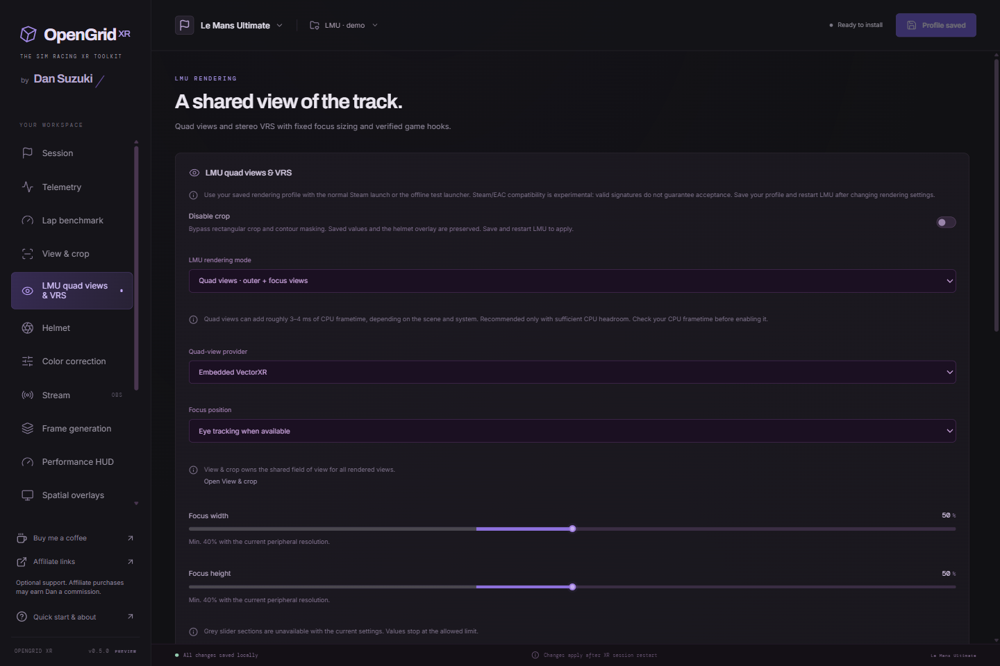

# LMU rendering

OpenGrid includes the LMU-specific renderer from [LMU Quad View Mod v0.2.1](https://github.com/DSuzuki35/LMU-Quad-View-Mod/tree/v0.2.1), commit `bf1189a6d841866b90eab2673b538eb06b471965`. Its native adapter is linked into `OpenGridXR.dll`; it is not a second registered OpenGrid API layer. Provider and headset combinations require their own validation; the earlier standalone result does not establish compatibility of every integrated configuration.



*0.5.0 demo configuration. The preview is illustrative, not a live game capture.*

## Use

Enable the LMU rendering module in Settings, select an LMU profile and open **LMU rendering**. Ordinary stereo remains the default. Select **Quad views** or **Stereo VRS**, save the profile, select the game executable and use **Check launch** before launching offline. Unknown executable hashes are rejected; native hook anchors are also checked in the game process.

### Normal Steam launch (experimental)

Save the LMU profile and install/update the runtime layer, then launch LMU in VR through Steam with EAC enabled. The registered OpenGrid layer reads the effective saved rendering configuration directly. The editor does not need to run. Disable the LMU rendering module or select **Off** to return to ordinary OpenXR on the next launch.

Remove the old OpenGrid `--lmu-steam-launch` option from Steam if you added it previously, preserving any unrelated launch options. The automatic path does not start a helper, alter EAC, reorder globally registered layers, or disable other tools. Existing per-game features in standalone tools can still conflict and should not duplicate the configured OpenGrid effects.

For QVFR, saving/installing prepares a byte-identical local copy of the installed provider under `runtime/providers/qvfr/OpenGridXR-QVFR.dll`. Its existing signature is preserved; it is not shipped as part of OpenGrid. A QVFR instance already present downstream is reused. Otherwise the private copy is inserted below the adapter, isolating its singleton state from a registered QVFR above OpenGrid that saw LMU's original stereo request. Saving backs up and updates only the LMU block in the provider's per-user settings. Other game blocks and the original provider DLL are preserved. The native pinned-executable and hook-anchor guards remain active.

The adapter owns its startup settings until instance destruction; explicit offline/capture launches keep precedence. Automatic starts disable dynamic focus, capture, benchmark and experimental profiling controls. Their native diagnostics use `runtime/logs/xr-layer.log`. Actual rendered-view status remains the evidence that quad rendering is active.

The automatic path was tested on 3 November 2026 on the Dream Air SE / SBoys3 / SteamVR / QVFR rig after removing the Steam launch option. The tester reached the VR cockpit. EAC reported successful in-game initialization at 15:07:43 UTC; the legacy handoff record was unchanged. Fresh native status reported quad/QVFR, ready hooks, four valid rendered FOVs, 322 x 302 outer images and 2576 x 2410 focus images per eye. The default automatic-path log recorded successful quad submissions through frame 4920. Both OpenGrid DLLs and the installed application passed Authenticode verification. This confirms that protected startup and four-view rendering worked in this session; multiplayer-server acceptance and extended visual driving tests were not established.

### Legacy Steam handoff (diagnostics)

The optional **Legacy launch option (diagnostics)** section retains the explicit process-isolated launcher. Its **Copy Steam launch option** button copies this form, with your installed executable path:

```text
"C:\Program Files\OpenGrid XR\OpenGrid XR.exe" --lmu-steam-launch %command%
```

Steam Play runs a short headless OpenGrid handoff, which reads the saved LMU profile and starts the original `start_protected_game.exe` with `+XR`. It uses the same per-process provider isolation, pinned game-build checks, frozen rendering configuration and static focus settings as the offline launcher. The editor can stay open. Save changes before launching; unsaved edits are not used. Remove the OpenGrid launch option to undo the setup, restoring any previous options you used.

Both OpenGrid DLLs and the protected launcher must pass Windows signature verification. The handoff refuses a direct `Le Mans Ultimate.exe` target and never falls back to an offline launch. EAC is not changed or disabled. A valid signature does not establish EAC approval: **online QuadView compatibility requires a separate protected-launch rig test**. A successful bootstrapper start is not proof that the game loaded the layer or rendered four views. Check the actual rendered views and game/EAC logs.

Run metadata records `launchMode: steam-eac`; the last handoff result is saved in `lmu-steam-last-launch.json` in OpenGrid's data folder. Do not use the offline launch or capture buttons to test EAC acceptance. Unsigned CI development builds do not pass the protected-launch signature check.

On 3 November 2026, the signed 0.4.1 build completed the normal Steam/EAC launch on the existing Dream Air SE / SBoys3 / SteamVR / QVFR rig. The EAC bootstrapper reported successful in-game initialization. Live OpenGrid status reported `mode: quad`, `provider: qvfr`, `hookStatus: ready`, valid four-view FOV data, 322 x 302 outer images and 2576 x 2410 focus images for both eyes. The renderer recorded successful quad submissions. This confirms the protected startup and active quad render path in that session; it does not establish multiplayer-server acceptance, long-session stability, or visual correctness during driving. No online race was validated.

**Disable crop** is shared between **View & crop** and the LMU page. It sends zero for all four crop edges and disables contour masking while preserving the saved crop and mask values. Helmet rendering remains independent, and helmet adjustments cannot turn this override off. Stream offsets, expansion and stabilization settings remain intact. Save and restart the sim to apply the change; turn the toggle off to restore the saved crop and mask behavior.

Quad providers:

- **Native:** the OpenXR runtime must provide quad views. Its recommendations own resolution and baseline focus dimensions.
- **QVFR:** uses an installed mbucchia Quad-Views-Foveated provider selected by its manifest. Launch creates a private explicit manifest and backs up/updates only an LMU settings block. Other application settings remain intact.
- **VectorXR:** uses the embedded OpenGrid enhancements engine as the quad provider; no separate VectorXR installation is needed.

Fixed or tracked gaze is available. Focus size and density are static. **Dynamic focus FOV is excluded**, including inherited environment controls. Resolution controls are linear multipliers: 200% in both dimensions means four times the pixel area, before focus coverage and runtime limits. A smaller focus FOV with fixed texture dimensions is not a guaranteed GPU saving.

Stereo VRS keeps two native eye renders and does not add focus passes. Supported NVIDIA devices use coarse shading only inside verified world passes; unsupported devices retain ordinary stereo. It is separate from quad rendering.

## Projection and processing

The adapter owns the four-direction crop, including asymmetric top/bottom crops. It supplies native outer geometry, focus geometry, HUD and submission from one rendered-frame snapshot. Later tracking queries can return fresh data without replacing metadata for pixels already rendered. Application submission poses and existing focus-pose compensation are preserved.

Cropped outer images are embedded into their original full-FOV output before submission. The focus is fitted inside the cropped outer. OpenGrid's former independent stereo crop and dimension adjustment are bypassed for this coordinated quad path. VectorXR composition uses the submitted rendered FOVs rather than overwriting them with later cached locate results.

OpenGrid processes borrowed images before their release. The aperture uses the original full-eye tangent coordinates projected into each outer/focus image. This final-image mask provides visual coverage; it does not imply that hidden focus pixels were never shaded. Sharpening uses the actual image regions.

Clean output merges owned raw outer and high-resolution focus images from the selected eye and the same completed frame. The GPU compositor uses the rendered FOVs, submitted poses and focus subrectangle, with a narrow two-texel edge blend. Its canvas preserves the cropped outer aspect and is sized for the configured stream resolution, rather than shrinking focus detail into the reduced peripheral texture. Normal stream framing, stabilization and stream overlays run afterwards. Copies and composition are gated by an active viewer and stream cadence; the headset images are unchanged. If the current focus image is missing or its geometry cannot be combined safely, output falls back to the current outer only. Native status distinguishes `ready-focus` and `ready-outer-only`; stale focus images are never reused.

**Keep full render area for stream** renders the full provider outer view and leaves the saved render crop inactive. Additional stream FOV expansion beyond those shared views is unsupported in quad mode and is reported in the UI.

## Isolation and compatibility

The offline and legacy Steam launchers use process-local explicit manifests and environment settings. They disable installed standalone OpenGrid, LMU adapter and competing quad providers for that child, then load the owned OpenGrid copy and exactly the selected external provider when needed. Global registry settings and parent-process environment are not modified. The automatic implicit-layer path preserves the registered chain and uses the private provider routing described above. Existing standalone launcher protection remains in the vendored upstream source.

The supported LMU executable SHA-256 is `66942337813B301B87D12EDFA330F33354A2A4B8CD9B048885CBF77EB6F940CF`. This is a pinned build, not a promise that future LMU releases work unchanged. Provider/runtime/device support still matters after the hash passes. The integrated path is Windows x64 / D3D11.

## Verify at the rig

On 2026-11-03, the integrated QVFR path reached the cockpit through SteamVR 2.18.4 after correcting the private engine's forwarding of the adapter's quad-view extensions. QVFR reported eye-tracking support, and native status confirmed successful four-view submissions. With peripheral density 50%, focus density 200%, focus section 40% × 40%, top crop 9% and bottom crop 20%, the tester confirmed matching, steady views in both eyes, including HUD and head movement. Dynamic focus FOV remained disabled. This is a visual check of that configuration; same-frame capture comparison, other providers and measured performance are separate checks.

Use **Launch with four-view capture**, load a track and request **Capture this scene**. A unique local run folder records the selected settings, hashes and render log; the capture produces `outer0.bmp`, `outer1.bmp`, `app0.bmp` and `app1.bmp` for one frame. Inspect RGB without interpreting BMP alpha as transparency. No capture is uploaded automatically.

A subsequent capture on the same rig used 10% peripheral / 200% focus density, 40% × 40% focus and 9% top / 20% bottom crop. All four files were captured from frame 3772, with matching capture/submission time and per-eye poses. The padded outers were 322 × 302 and focus images 2576 × 2410. A tangent-FOV-aligned diagnostic composite was visually checked for both eyes, cockpit geometry and HUD. This single-frame check does not replace temporal testing or measure performance. The clean-output compositor has GPU regression coverage for same-frame pairing, both eyes, moved focus, relative rotation, subrectangles, missing focus and disconnected viewers.

After installing the compositor, the tester confirmed a sharp, correctly aligned focus in Clean Output during head and gaze movement with that 10% / 200% configuration. Live native status reported `ready-focus`, selected right eye, 322 × 215 cropped outers, 2576 × 2410 focus images and a 1920 × 1282 composite before output framing. This validates that configuration visually; no measured GPU-performance claim or blanket provider compatibility is implied.

Compare each outer/focus pair using the logged tangent-space FOV bounds, not a simple image resize. Check both eyes, HUD/menus, fixed and tracked gaze, head movement and crop on/off, including asymmetric 8% top / 21% bottom. Check clean output and sharpen/mask alignment. The UI displays actual rendered focus FOV and image dimensions only while the native session status is live. Capture readback must be excluded from performance measurements.

If gaze does not move, first confirm the XR session is focused and the SteamVR dashboard is closed. In the reported standalone setup, restarting eye tracking in Pimax Play was also necessary. That observation does not establish a general cause or fix for every runtime.

## Source and notices

Pinned native sources, tests and original notices are under `native/third_party/lmu_quadview`; OpenGrid integration changes are identified in its provenance file. The LMU implementation uses PolyForm Noncommercial, with separate MinHook, NVAPI and OpenXR terms retained. VectorXR modifications remain MPL-2.0. See the root third-party notices and native build instructions.
