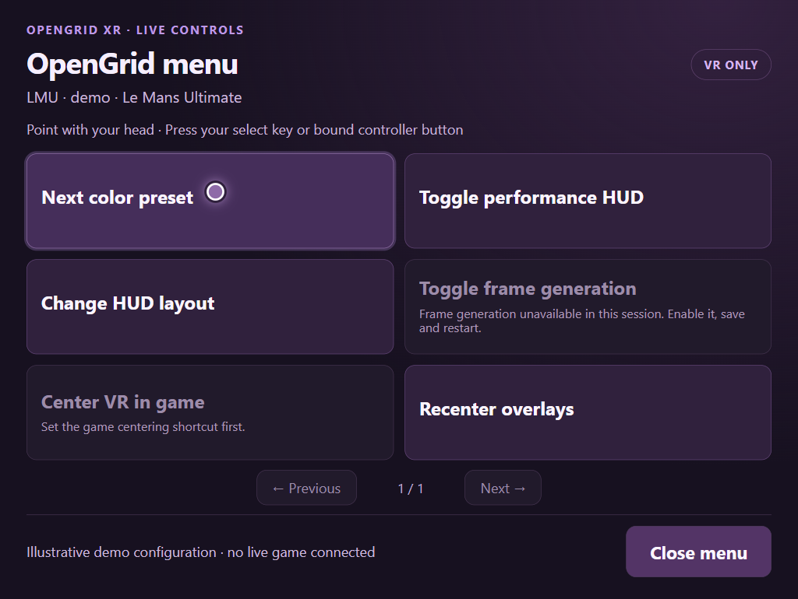
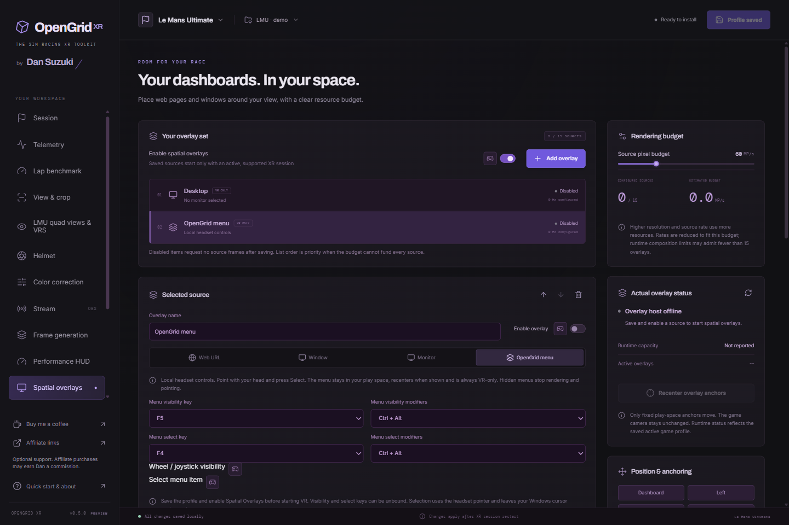

# Use the OpenGrid menu in VR

*Actual 0.5.0 local menu renderer with generic illustrative state. This is a configured example, not a live game capture.*

## Add and open it

1. Enable **Spatial overlays** in Setup modules and in your saved profile.
2. Add an overlay and choose **OpenGrid menu**. Leave the source hidden/off, then **Save profile**. Restart the sim if the overlay engine was not enabled at session startup.
3. Press **Ctrl+Alt+F5** to show the menu. A new source starts hidden and recenters in front of your current head position when shown. If you save it visible, it will also be visible next time; hide it before closing to keep it hidden on the next run.
4. Point with your head. Press **Ctrl+Alt+F4** to select the highlighted button. Use **Close menu** or the visibility key to hide it.

In the source editor, change or unbind **Menu visibility** and **Menu select** keys. Duplicate shortcut assignments are rejected; a default already in use may start unbound. Learn optional wheel, joystick or buttonbox inputs beside visibility and **Select menu item**. No physical button is assigned automatically. Save after learning; unsaved edits or a busy editor pause shortcut/controller actions.

*Actual 0.5.0 source editor with a generic demo profile; the source is configured but not running in VR.*

## What can change live?

| Control | Requirement |
| --- | --- |
| Cycle VR color preset | Color correction enabled at session start |
| Toggle Performance HUD or change its layout | HUD enabled at session start |
| Toggle frame generation | Frame generation enabled at session start |
| Show/hide a saved overlay, including desktop | Saved source available; desktop/window capture explicitly selected in this app run |
| Center VR in game | Saved game-recenter shortcut matching the sim |
| Recenter overlays | Active local overlay anchors |

Unavailable actions show their reason. Acknowledgements and errors appear in the menu. Live color, Performance HUD and frame-generation controls do not rewrite startup preferences. Showing or hiding an overlay or the menu saves that source's visibility for the next run. Profile editing, render geometry and other restart-required settings remain in the desktop editor. Use Previous/Next for more action cards.

## Placement and privacy

One menu is allowed per profile. It is a local-space panel, approximately 1 m forward and 0.9 m wide by default, with editable pose, size and opacity. It cannot follow the head: the head ray must move across it to select buttons. Default texture is 1024 × 768 at up to 15 Hz.

The menu is local/offline and VR-only; it cannot be added to Clean Output. It uses explicit head pointing and select presses, with no eye input, blink selection, dwell clicks or desktop cursor injection. It has no access to the full profile editor. Hiding it disposes its source renderer and pointer updates. Visible rendering has a resource cost; headset performance must be checked on your rig.

For desktop interaction and precision holds, see [Spatial overlays](spatial-overlays.md). The desktop uses its own explicit input/capture rules.
