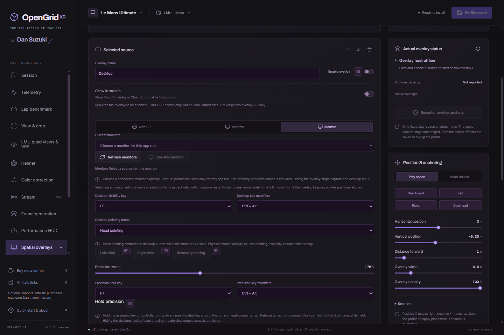

# Spatial overlays

Save up to 15 independently configured overlays per game profile. A source is an HTTP(S) webpage, an explicitly selected application window, a connected monitor, or the local [OpenGrid menu](quick-menu.md) (one per profile). Dashboard URLs on localhost are supported. Remote pages run in sandboxed renderers without Node integration or access to OpenGrid's controls. Downloads, popups, audio capture and unrequested permissions are blocked.

*0.5.0 demo profile; capture is inactive and no personal desktop is shown.*

## Add a source

1. Enable Spatial overlays, add a source and choose Web URL, Window, Monitor or OpenGrid menu.
2. Enter the URL or explicitly select the window/monitor; menu needs no URL or capture permission.
3. Enable the source, set placement and save. Restart the sim if enabling the engine for the first time.

For the local headset controls and default visibility/select keys, see [Menu setup](quick-menu.md).

## Monitor capture and desktop interaction

Choose **Monitor**, **Refresh monitors**, then **Use this monitor** and save the profile. Monitor permission lasts for the current OpenGrid run. A saved display reference alone never starts capture. Removing a monitor or changing its geometry/DPI revokes that selection; explicitly choose the current monitor again. Capture includes the ordinary Windows cursor. Turning the overlay off, setting opacity to zero, disabling spatial overlays or ending the XR session stops capture and withdraws its desktop input target.

The source summary below the picker shows the chosen monitor and physical resolution, application-window title, or dashboard title and URL. It stays visible when the picker clears or the desktop is hidden. **Showing in VR** means the native layer has actually consumed a rendered frame; a selection alone is labeled **Selected · not showing in VR**. Restarting OpenGrid requires selecting monitor/window capture again; a saved label never grants capture permission.

Selecting a monitor sets its source resolution to the monitor's aspect ratio within the 1920 × 1080 capture limits. Desktop video fills the entire overlay with the uncropped monitor. If you choose custom dimensions with a different aspect ratio, the image stretches to fit, so every visible position still maps to the corresponding monitor position without actionable letterbox bars. Application-window capture keeps its existing contain behavior.

**Desktop visibility key** accepts F1–F12 with optional Ctrl, Alt and Shift. Save it to activate the global shortcut. It toggles the saved monitor overlay without restarting the runtime; shortcut conflicts appear beside the source. Use the controller binding beside the monitor's visibility switch to learn a wheel, joystick or buttonbox button. Each time a local desktop is shown, its anchor aligns to the current head position and yaw; set X/Y and rotations to zero for a centered panel. Shortcuts and controller actions pause while profile edits are unsaved or the editor is busy.

**Physical mouse** is the default pointing mode. Use the ordinary PC mouse; OpenGrid does not move or click it. **Head pointing** explicitly hands cursor movement to the headset ray where it intersects the displayed overlay. Pointer coordinates use the selected monitor's physical Windows rectangle, including negative positions and mixed DPI. Desktop input requires a visible, valid, fresh native target. Movement of the physical mouse pauses head input; use **Resume pointing**, or its controller binding, to explicitly return control.

In head mode, **Left click** and **Right click** can be assigned wheel, joystick or buttonbox inputs. These are momentary actions and do not change saved profile fields. Hidden, disconnected, stale or unavailable targets cannot click. The mode and input status are shown with the source. Desktop interaction is head-only or physical-mouse input; no eye cursor or wink selection is available. Legacy eye-input profiles migrate to head pointing. Game foveated rendering keeps its separate tracking path.

### Hold precision

Choose **Head pointing**, set **Precision zoom** between 100% and 300% (175% default), and assign a **Precision hold key** or learn a controller input beside **Hold precision**. Keyboard holds use F1–F12 with optional Ctrl/Alt/Shift; choose a different chord from the desktop visibility key. Save the profile before using it.

Hold that input while pointing at the desktop. Only the desktop panel enlarges, anchored around the current pointer target, so small buttons require less precise head movement. Use your normal left/right click binding while holding precision. Release to restore the normal panel. If both keyboard and joystick hold it, release both. The game camera and its FOV are unchanged; Clean Output uses the same enlarged overlay geometry when sharing is enabled.

Hidden/disconnected desktops, focus loss, physical-mouse takeover and source changes cancel precision. A held joystick press requires fresh hardware state reports; missing reports expire the hold within 300 ms. An old held press cannot rearm after cancellation until released and pressed again. Keyboard sampling and controller forwarding run outside the VR render thread. Use a play-space anchor for head pointing; a head-locked panel follows the head ray instead of letting it aim across the desktop.

## Placement

Head-following overlays use the headset view space. Local overlays stay at a chosen pose in the OpenXR local space and can be arranged around the seated driver. Position uses meters, with negative Z in front of the viewer; yaw, pitch and roll use degrees. The physical height follows the source aspect ratio. This is an overlay anchor, not a tracked attachment to a moving game's cockpit mesh.

Drag an overlay in the **Placement map**. **Top · X/Z** adjusts left/right and distance forward; **Front · X/Y** adjusts left/right and height. The third axis stays unchanged, and numeric controls follow the map. Arrow keys move 1 cm, or 10 cm with Shift; Escape cancels the current drag. The map shows positions relative to each overlay's anchor, without source content or rotation. Save the profile to apply edits.

Recenter overlays aligns local anchors to the current head position and yaw. It does not recenter the game's camera. **Center VR in game** sends the explicitly saved keyboard shortcut after a short delay so the driver can focus the sim. Assign the same shortcut to the sim's VR recenter action first. No input is sent if the selected sim is not foreground or modifier keys are held. No universal runtime recenter API is assumed.

Use the controller button beside **Wheel / joystick centering** to learn a wheel/joystick button or POV direction. It triggers the saved game shortcut with the saved delay. Save the new binding before driving. Unsaved edits pause bindings; changing the editor state cancels a pending controller-centering command.

## Choose what appears in the stream

Each enabled non-menu overlay has a separate **Show in stream** switch, off by default. Enable it only for sources intended for viewers. The stream uses the overlay's VR position, size, orientation and opacity. It projects that geometry through the selected captured eye and the same crop/stabilization camera as the game image, before display letterboxing. There are no separate 2D placement controls for the stream.

An independent keyed GPU texture ring carries selected overlays into Clean Output after the stabilized game image. It is allocated and updated only while both the source is selected and a live Clean Output consumer exists. Selecting a static dashboard can reuse its latest retained GPU image without forcing a webpage reload. Turning the switch off, clearing a source or losing its producer withdraws its cached stream image. List order controls stacking. Runtime VR layer limits do not by themselves prevent an explicitly selected source from appearing in the 2D stream.

## Resource controls

- Sources are created only for saved, enabled overlays while a fresh OpenXR session has the overlay engine loaded. No background service starts with Windows.
- Web/window/monitor default source size is 1024 × 576 at 10 Hz. The local menu defaults to 1024 × 768 and is capped at 15 Hz. Maximum size is 1920 × 1080 at 30 Hz. The default combined budget is 60 million source pixels/second.
- The combined budget reduces effective frame rates. If it cannot fund even 1 Hz for every source, later sources pause; ordering provides priority. It bounds requested frame transport, not arbitrary JavaScript/WebGL work inside a webpage.
- Shared GPU textures avoid a full-frame CPU bitmap round trip. At most one source frame per overlay is awaiting acknowledgment. Busy sources drop frames; the VR render path retains the last complete image rather than waiting for a webpage.
- Unchanged pages produce no new texture frames. Disabled sources release browser/capture resources. Multiple active browser pages still consume memory and can run expensive scripts, so use compact dashboards and low update rates where possible.
- The OpenXR runtime's layer limit is respected after game and performance-panel layers. Fifteen saved overlays do not guarantee fifteen simultaneous layers on every runtime. Layer-limit and source errors are shown explicitly.
- Browser capture and the game must use compatible GPUs. Cross-adapter import failures stop the affected source rather than switching to expensive CPU transport. On hybrid-GPU laptops, configure the application and sim to use the same GPU in Windows graphics settings.

Window IDs are only trusted after a selection in the current application session. Reselect after restarting OpenGrid or reopening a captured window. Minimized/protected windows and GPU/runtime combinations can restrict capture. Overlays remain separate from the captured game image; only sources explicitly selected with **Show in stream** are composited into Clean Output.

## Verification limits

The source sandbox and real Electron shared-GPU handles have been exercised on the development machine. End-to-end animated webpage and window-capture transfer has passed through the native host into both D3D11 and D3D12 synthetic runtime images with GPU pixel readback. Closing the captured window reports capture termination. These tests do not establish live-game, capture-card or Pimax/RTX 5090 performance. Chromium's documented shared-texture API does not expose a producer fence for BGRA/RGBA on Windows; source lifetime is retained through our completed GPU-copy acknowledgment. Treat this path as experimental until tested with the target driver/runtime combination.
