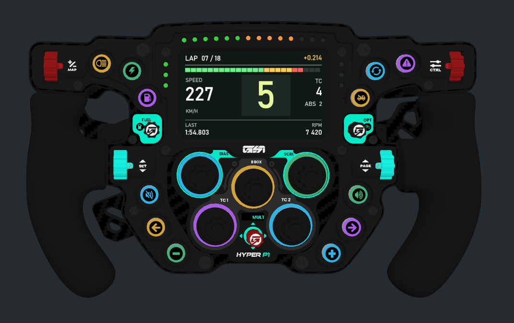
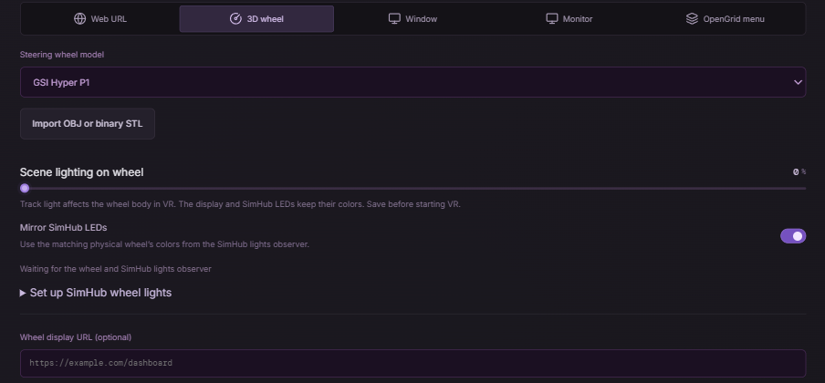

# Steering wheels in VR

*GSI Hyper P1 rendered by OpenGrid XR’s D3D11 wheel renderer with sample dashboard values and LED colors. Model by Gomez Sim Industries, prepared for oVRlay. [Model provenance](../assets/wheels/hyper-p1-provenance.json).*

In **Spatial overlays**, add a source and choose **3D wheel**. Select a bundled GSI or Ascher Artura model, or choose **Import OBJ or binary STL**. Enable the overlay and save the profile. Start a supported iRacing or Le Mans Ultimate OpenXR session, with the Spatial overlays module enabled.

| Model | Wheel width | Live display |
| --- | --- | --- |
| GSI Hyper P1 | 300 mm | Yes |
| GSI Hyper SL | 300 mm | — |
| GSI GXL V2 | 300 mm | — |
| GSI GT-MAX 32 | 320 mm | Yes |
| GSI FPE2 | 300 mm | Yes |
| Ascher Artura Ultimate | 300 mm | Yes |

The Ascher Artura model was provided by Martin Ascher. It includes the supplied muted materials and shaft offset, a fitted SimHub display, 21 shift lights and 14 illuminated button symbols. Light colors follow SimHub’s Artura Ultimate device output.

All six built-in wheels can show an optional **Driver (experimental)** with gloved hands, themed sleeves and optional torso/legs. Anatomy and regripping are still approximate; custom imports are not supported. [Driver setup and preview](driver-test.md)

## Place the wheel

Center your physical wheel. Use **Place in front of me** or the position and rotation fields to align the shaft and rim. The width field controls physical wheel width in meters. **Follow steering wheel** rotates the model with the sim’s steering telemetry. The GSI meshes use their shaft origin as the pivot. For an imported model the pivot starts at its bounding-box center. Adjust the pivot offsets and steering axis tilt if necessary. Save the profile. To keep an alignment for a particular car, enable **Remember placement for this car**. [Dashboard placement controls](spatial-overlays.md#place-a-web-dashboard)

The renderer draws each eye from its own viewpoint, including the back of the rim, paddles, buttons and display. In a stereo session, a wheel uses one stereo projection layer. Four-view sessions keep the pair of eye-specific quad layers. Lower the source width to reduce the wheel render resolution. The renderer caps ordinary wheels at 1024 pixels per eye; wheels with a loaded experimental driver use 1536 pixels. Enable **3D model without occlusion** to draw that wheel without testing against the game’s cockpit depth. Hands and cockpit parts will no longer hide it. This also removes its depth-processing demand; another overlay with occlusion enabled can still require that work. With the option off, the wheel uses the sim’s stereo depth when available. Benchmark both settings on your system. **Show in stream** sends the flat dashboard feed to Clean Output at the overlay’s placement. The headset receives the 3D mesh.

Multiple overlays using the same wheel share its geometry on the GPU. OpenGrid loads meshes and compiles shaders in the background. Disabling an overlay lets pending work finish in the background. Closing the OpenXR session joins outstanding workers before the layer releases its graphics device.

## SimHub display and LEDs

**Scene lighting on wheel** adjusts how strongly track light affects the wheel body in VR. Try 60%, save before launching the sim, then compare the pit garage with the open track. At 0% the wheel keeps its usual lighting. The SimHub display and active LEDs keep their own colors. If the game image cannot be sampled, the wheel keeps its usual lighting. D3D11 and supported native D3D12 sessions can supply the lighting sample.

For a wheel-mounted dashboard, use **Play space** and **Follow steering wheel**. This follows steering and lets you look around naturally. Game-generated cockpit camera shake is not tracked. If the dashboard drifts on bumps, reduce in-game cockpit camera motion. **Head-locked** attaches the dashboard to your headset, including when you look away.

In SimHub Dash Studio, open your dashboard’s browser display and copy its HTTP or HTTPS URL. Paste it into **Wheel display URL (optional)** and save. Localhost URLs work. On the Hyper P1, GT-MAX 32, FPE2 and Artura Ultimate, OpenGrid fits this page to the model’s display surface. Hyper SL and GXL V2 have no display.

To mirror the physical device’s lights, enable **Mirror SimHub LEDs** and install or enable the SimHub observer. The source panel reports when colors arrive. Each model uses its own physical LED layout. For the Artura, use an observer build that supports **Ascher Artura Ultimate**; an older observer will not forward its colors. The dashboard and LED observer run independently. [SimHub observer setup](simhub-wheel-lights.md)

## Import a wheel

Export a Wavefront OBJ or **binary** STL with the driver viewing the front along the positive Z axis, X pointing right and Y pointing up. OpenGrid normalizes the model to unit width and starts it at 300 mm. Set the physical width to match your wheel.

- **OBJ** supports vertices, texture coordinates and polygon faces, including negative indices. Triangulate concave polygons in your modeling application. The importer computes face normals. Ordinary surfaces use a neutral gray finish. It reads geometry from the selected file only.
- **STL** supports triangle geometry. Both formats can use a live screen. If a custom wheel has no authored screen surface, supplying a dashboard URL fits a display near the upper center of the front of the model.
- For a precisely fitted OBJ screen, assign the material name `screen` to its faces and unwrap their UVs in the 0–1 range. The bottom-left corner of the dashboard corresponds to OBJ UV (0, 0).
- To drive custom OBJ LEDs, assign the material names `led_1`, `led_2`, and so on to the diffuser faces. Numbers are one-based physical LED indices. Select the matching **SimHub LED device** in the source panel. For example, `led_1` follows the first physical pixel in that device’s completed SimHub output.
- Each input may be up to 32 MiB and 250,000 output triangles. A face may have up to 256 vertices. Converted geometry is stored under `%LOCALAPPDATA%\OpenGridXR\wheels`. A profile stores a content identifier. When moving to another PC, import the same OBJ or STL there to restore the model.

Switching to a model without a display pauses the SimHub dashboard. Select a wheel with a screen to use the saved URL again. Imported models stay in the selector while the panel is open.
