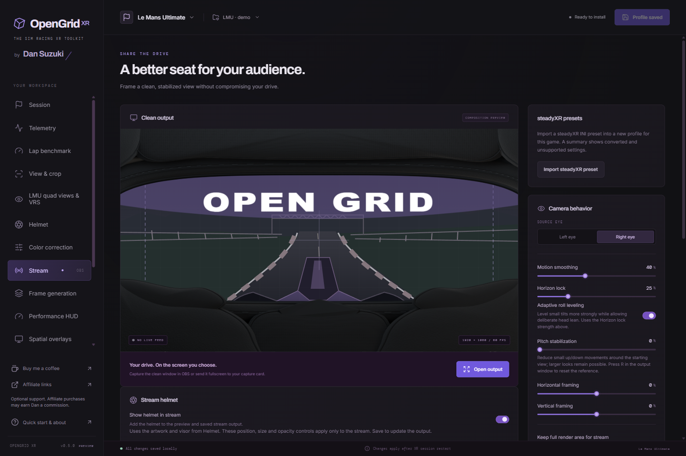
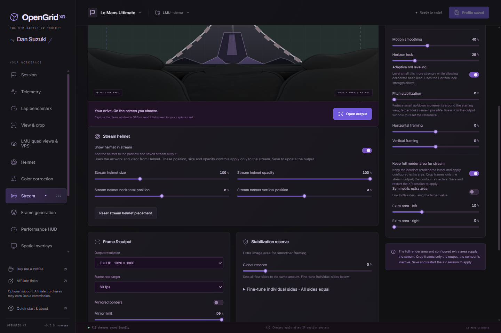

# Set up Clean Output

*0.5.0 demo configuration; the preview is illustrative, not a live game feed. FPS is the configured output target.*

## Choose how much the game renders

*0.5.0 demo settings. This option replaces the former global Driving/Streaming selector.*

With **Keep full render area for stream off**, rectangular crop adjusts the OpenXR projection and recommended render dimensions together. Render scale controls pixel density. A freeform contour can add a conservative exterior hidden-area mesh, with padding. The game must query and use the hidden-triangle visibility mask for that optimization to have an effect. A polygon is not a guarantee of GPU savings. The runtime must permit mutable FOV for rectangular crop.

With **Stream → Keep full render area for stream on**, the native layer preserves the full source and can expand its horizontal projection. The saved custom contour is inactive. Rectangular crop becomes output framing; it does not reduce headset rendering in this mode. Both eyes currently receive the requested expansion. This reserves source content for smoothing and horizon stabilization. Larger render dimensions are recommendations; the game may ignore them.

The global Driving/Streaming selector was removed in 0.5.0. Existing profiles migrate to the matching explicit option; the saved contour is retained. Disabling the Clean Output module makes the effective option off without erasing its preference.

Render/contour changes are snapshots at game session startup: restart the game to apply them. From **0.6.0**, stabilization reserve and horizontal/vertical framing preview **while you move the controls** in an open Clean Output window launched by the app. **Save profile** makes them permanent; discarding edits or switching profiles restores saved framing. Other output settings still require closing and reopening Clean Output. No live geometry resizing occurs underneath the game.

**Stream stabilization:** **Adaptive roll leveling** uses the Horizon lock strength to reduce small tilts while retaining deliberate lean. **Pitch stabilization** reduces small up/down movements around the initial view. Press **R** with the output window focused to reset the horizon/pitch reference. **Mirrored borders** includes a maximum extension, softness and stretch. Stabilization and border effects run in the existing output pass; softness adds samples only in reflected areas.

**steadyXR presets:** use **Stream → Import steadyXR preset** to read a saved `.ini` file into a new, unsaved profile with full render area enabled for the selected game. The summary lists imported settings and any clamping, selected-eye conversion or unsupported fields. Monitor bindings, source paths, shortcuts and other steadyXR modules are not applied. Review the summary, choose your output display and save.

**Stream helmet:** enable **Show helmet in stream** to include your Helmet artwork and visor in the composition preview and actual output. Stream position, size and overall opacity are separate from the headset settings. Saved artwork updates in an open output window; it is prepared once on save and composited after stabilization. The preview is an illustration, not a live game feed.

**Disable crop**, available in both **View & crop** and **LMU rendering**, bypasses rectangular crop and contour masking without clearing their saved values. Helmet rendering remains independent. Save and restart the sim to apply it; turning it off restores the saved crop and mask behavior. Stream offsets, expansion and stabilization remain configured.

For LMU quad views, the integrated adapter coordinates outer and focus projections. Keeping full render area preserves the provider's full outer view; extra stream FOV expansion is unsupported for this path. Clean Output combines the current frame's outer and high-resolution focus image before normal framing and stabilization, falling back to the current outer image if a usable focus image is unavailable. See the [LMU projection and processing contract](lmu-rendering.md#projection-and-processing).

## Two-PC capture-card output

1. Connect a gaming-PC GPU output to the capture card on the stream PC. Configure it as an **extended Windows display**.
2. In **Stream**, select that output display, set the internal canvas resolution/FPS, and enable **Start fullscreen**.
3. Save the profile, install the connection if needed, and start/restart the OpenXR game.
4. Select **Open clean output**. It opens a separate native window on the selected monitor, in borderless fullscreen. The settings app stays separate from the captured image.
5. **F11** toggles fullscreen. **Esc** returns to windowed mode; a second Esc closes the window. If the monitor is disconnected, choose a connected output before launching.
6. In **Spatial overlays**, use **Show in stream** per enabled source. Selected overlays retain their VR placement in the streamed camera view. Sources are VR-only by default. The additional stream texture ring runs only while Clean Output is active.

Set the Windows display mode to the capture card's supported resolution and refresh rate; selecting a canvas/FPS in OpenGrid XR does not reconfigure Windows or the capture card. Game audio is configured separately. On one PC, OBS can capture the Clean Output window. A direct OpenGrid XR OBS source plugin is not included.

**Symmetric extra area** links both expansion sliders. Turning it on sets both to the larger existing side; turning it off keeps the values for independent editing. The choice is stored in each profile.

**Stabilization reserve** crops the game image to leave room for stabilization: more reserve means more zoom. **13% on each side** keeps the central **74%**, approximately **1.35× zoom** compared with zero reserve. Expand the individual controls to fine-tune left, right, top and bottom. With different margins, the global value shows their average; moving it sets every margin to the new value. Changes preview live; save to keep them. The stream helmet keeps its separate size and position.

The output uses D3D11 shared textures, so its graphics adapter must be compatible with the game's. Supported stereo D3D11 projection capture is the initial path. Unsupported capture formats/view modes should remain pass-through for the game and must not be represented as working capture. No automatic game launch or runtime switch is performed.
