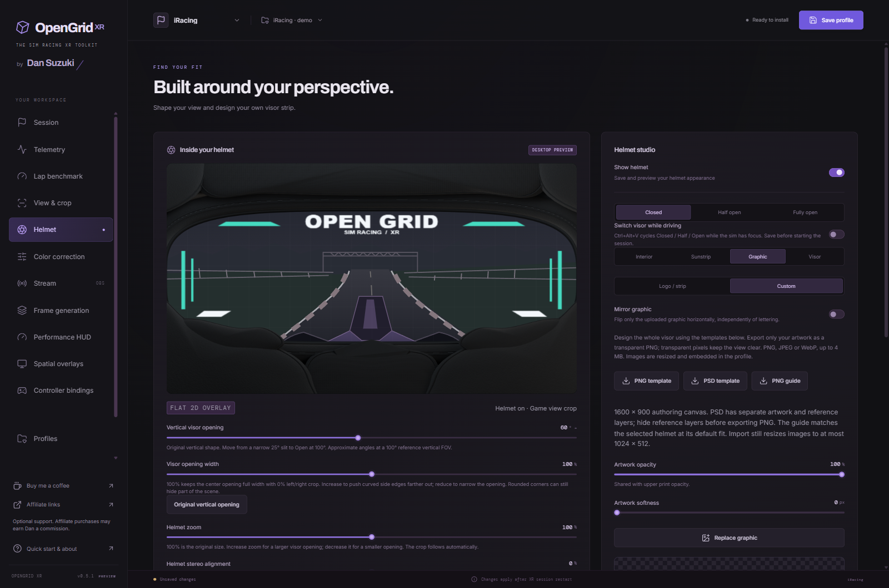
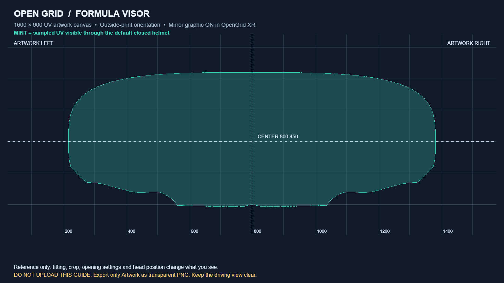

# Full visor artwork templates

In **Helmet → Graphic**, choose **Custom** for artwork placed across the visor. **Logo / strip** keeps the existing logo placement behavior. These files use a **1600 × 900 transparent canvas** in the visor's flat UV coordinates; the helmet projection curves the artwork when it is baked.

[Download the blank artwork PNG](../public/templates/visor/visor-template.png) · [Download the transparent OPEN GRID example](../public/templates/visor/generic-example.png)

| Helmet | Editable PSD | Separate PNG reference |
| --- | --- | --- |
| Formula | [Formula PSD](../public/templates/visor/visor-template-formula.psd) | [Formula guide](../public/templates/visor/visor-guide-formula.png) |
| GT | [GT PSD](../public/templates/visor/visor-template-gt.psd) | [GT guide](../public/templates/visor/visor-guide-gt.png) |
| Open | [Open PSD](../public/templates/visor/visor-template-open.psd) | [Open guide](../public/templates/visor/visor-guide-open.png) |
| Level3 | [Level3 PSD](../public/templates/visor/visor-template-level3.psd) | [Level3 guide](../public/templates/visor/visor-guide-level3.png) |

The editor's Graphic page also offers the blank PNG, guide and PSD for the selected helmet. Repository links above work from a local checkout without a web service.

*Actual 0.5.1 editor with an isolated demo profile and the supplied transparent example; the driving scene is illustrative.*

## Draw, export, upload

1. Open the PSD for your helmet in an editor that supports layered PSD files. All reference layers start hidden; enable **REFERENCE**, **Visibility** and **GUIDES** while drawing. Alternatively, open the blank PNG and place the separate guide on a temporary layer.
2. Draw on **Artwork — export this layer only**, or add your own artwork layers above it. Keep the canvas at **1600 × 900** and preserve transparency. Position and size the design in the file itself; Full visor centers the whole canvas and preserves its aspect ratio.
3. Hide every layer marked **DO NOT EXPORT**, including any separate PNG guide. Export only your artwork as a transparent PNG with the original canvas dimensions. Save the layered PSD separately for later edits. OpenGrid XR imports the exported image; **it does not import PSD files**.
4. In the helmet editor, choose **Graphic → Custom**, upload your PNG and check the result with your actual fitting settings. The artwork works with **Upper sunstrip** switched off. Opacity, softness and mirror still apply; the old logo width/X/Y controls belong to Logo / strip mode.
5. Check Closed and Half open. Artwork rises with the visor in Half open and disappears in Fully open. Keep the driving view clear and test the final result in your headset.

The mint area is sampled from the supplied helmet's actual 16-bit U/V projection maps, excluding pixels hidden behind the opaque closed shell. A one-pixel fill closes raster sampling gaps. It is a **default closed-fit reference**, not a guarantee that all marked artwork will always be visible. Fitting, crop, opening settings, visor position and head position change what you see. Areas outside the reference may be hidden; Level3 has a particularly narrow visible region.

## Mirror and resolution

Author text normally, as it would read on the **outside** of a printed visor. **Mirror graphic is on by default**, so the driver sees the reverse of that outside print from inside the helmet. The guides use this default orientation. To make uploaded text read normally from inside, turn Mirror graphic off and flip the visibility reference horizontally while positioning asymmetric artwork; verify the preview before exporting your final version. **Sunstrip → Mirror lettering** controls typed text separately.

The template is an authoring canvas, not a promise of native full-resolution 4K print. Existing image limits still apply: uploads are at most **4 MiB**, decoded images at most **16 megapixels**, and the embedded graphic is normalized to fit within **1024 × 512 pixels** and **192 KiB**. A 16:9 image therefore fits inside those bounds with preserved aspect ratio. Fine lettering can lose detail during normalization, so use larger shapes and inspect the imported image.

The generic OPEN GRID example contains only artwork on transparency. It demonstrates peripheral accents and a clear center; different helmets reveal different parts, so adapt it using your style's guide. It is a starting point rather than a universal fit.

## Rebuilding the files

Run `node scripts/build-visor-templates.cjs` after installing the repository's development dependencies. The generator uses isolated Electron Canvas for raster layers and [ag-psd](https://github.com/Agamnentzar/ag-psd) with raw ImageData for real editable PSD layers; it does not require node-canvas. Run `node --test tests/visor-template-assets.test.mjs` to verify PNG transparency, editable layers, hidden references and correspondence with the actual helmet maps.
